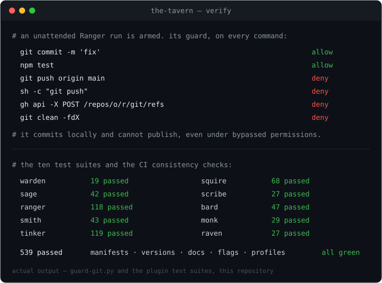
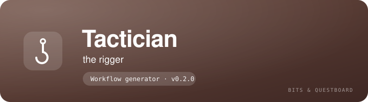
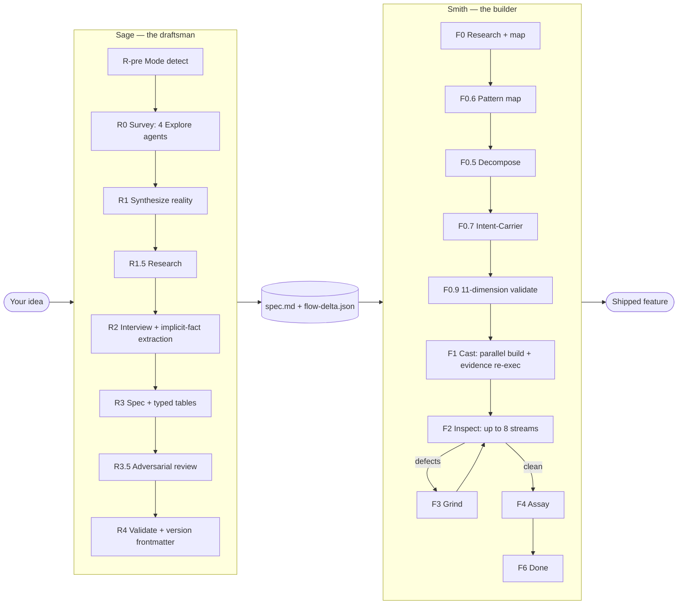

<div align="center">


[](https://github.com/gshepptech/the-tavern/actions/workflows/ci.yml)
[](LICENSE)
[](#the-crew)
[](https://docs.claude.com/en/docs/claude-code)
[](CONTRIBUTING.md)
[](https://github.com/gshepptech/the-tavern/commits/main)
[](https://github.com/gshepptech/the-tavern/stargazers)

<br/>

**Nine AI builders for Claude Code. Hire one, or hire the crew.**

[Install](#install) · [The Crew](#the-crew) · [Which one do I need?](#which-one-do-i-need) · [Using them together](#using-them-together) · [Contributing](#contributing)

</div>

---

> [!NOTE]
> **The Tavern** is a [Claude Code](https://docs.claude.com/en/docs/claude-code) plugin marketplace of nine independent tools. **Every one of them works entirely on its own** — install a single plugin, use it, and never touch the other eight. Each has its own README, its own commands, and no dependency on the rest.
>
> They also compose, and some pair unusually well. But composition is an option, not the price of entry.

<div align="center">



</div>

## Contents

- [Install](#install)
- [Start with a profile](#start-with-a-profile)
- [The Crew](#the-crew)
- [Which one do I need?](#which-one-do-i-need)
- [Using them together](#using-them-together)
- [Per-plugin docs](#per-plugin-docs)
- [Contributing](#contributing)
- [License](#license)

---

## Install

Add the marketplace once:

```bash
/plugin marketplace add gshepptech/the-tavern
```

Then install whichever tradesperson you actually need. There is no required base install and no particular order:

```bash
/plugin install sage@the-tavern       # spec engine
/plugin install smith@the-tavern      # autonomous builder
/plugin install warden@the-tavern        # methodical-mode guardrails
/plugin install sellsword@the-tavern        # multi-agent problem crew
/plugin install cleric@the-tavern      # low-risk cleanup
/plugin install scout@the-tavern       # browser end-to-end tests
/plugin install tactician@the-tavern      # Workflow-script generator
/plugin install seer@the-tavern    # design-cohesion review
/plugin install ranger@the-tavern     # unattended improvement loop
```

> [!TIP]
> Not sure where to start? Pick the one whose job matches the problem in front of you today — see [Which one do I need?](#which-one-do-i-need). Every plugin's own README covers its full setup, so you never need to read this page to use one.

> [!WARNING]
> **What you are installing.** These are plugins, so some of them run code on your machine as a matter of course, and two of them are built to run without you watching. Worth knowing up front:
>
> - **Hooks execute on every turn.** Warden installs `UserPromptSubmit` and `Stop` hooks that run local scripts on every prompt and every response, in every project, for as long as it is installed. Ranger and Sellsword install `PreToolUse` / `Stop` hooks that are active while a run is armed. Updating the marketplace pulls new code that runs immediately.
> - **Unattended modes bypass permission prompts.** Ranger's headless runner and `/sellsword:goal` run with permissions bypassed, because there is no human present to answer. Ranger's git guard still blocks publishing, and `/sellsword:goal` reaches real infrastructure over SSH. **Run those in a container, a VM, or a throwaway clone — not on a machine you care about.**
> - **They spawn Opus subagents, sometimes many.** Each plugin's README has a "What it costs" section giving the shape of a run and the flags that bound it. Read it before your first unattended run.
>
> Everything else — Sage, Smith, Cleric, Scout, Tactician, Seer — runs in your session under your normal permissions.

Warden is the only plugin that starts working the moment it is installed: every new conversation gets the methodical preamble plus the Stop-hook gates. `/warden:status` to inspect, `/warden:casual` to skip a trivial turn, `/warden:off` to silence it until you run `/warden:on`.

---

## Start with a profile

Nine plugins is nine decisions, and nobody arriving for the first time has the information to make them. If you would rather not choose yet, install a named set and add the rest when you find out you want them:

```bash
git clone https://github.com/gshepptech/the-tavern && cd the-tavern
./scripts/install-profile.sh daily
```

| Profile | Plugins | For |
|---|---|---|
| `daily` | warden, sage, cleric | Working solo on a codebase you did not write |
| `pipeline` | sage, smith | Specifying a feature and having it built out |
| `review` | seer, cleric | Assessing and tidying, without autonomous writing |
| `unattended` | sellsword, ranger | Work that runs while you are away. Bypasses permissions |
| `all` | all nine | You want the crew |

`--list` shows what each contains, `--dry-run` prints the commands and runs nothing, and `--scope project` writes a committed `.claude/settings.json` so everyone cloning the repo gets the same set.

Do not want to clone anything? A profile is only a list of plugin names, so this is the whole of `daily`:

```bash
/plugin marketplace add gshepptech/the-tavern
/plugin install warden@the-tavern
/plugin install sage@the-tavern
/plugin install cleric@the-tavern
```

> [!IMPORTANT]
> Profiles are a convention of this repo, not a Claude Code feature. There is no bundle or group in the marketplace manifest, and **no plugin here depends on another**. A profile is a shortcut for people without an opinion yet, and installing one plugin on its own stays the first-class path.

> [!WARNING]
> The `unattended` and `all` profiles include **Sellsword and Ranger, which run with permissions bypassed** in their unattended modes. Read the warning under [Install](#install) before you run one. Installing them is safe, since nothing runs until you invoke it, but `/ranger:run` headless and `/sellsword:goal` belong in a container, a VM, or a throwaway clone.

[docs/profiles.md](docs/profiles.md) has each profile in full: who it is for, exactly what it leaves out, and the honest cost.

---

## The Crew

| Who | Trade | Runs alone | Key commands |
|---|---|---|---|
| **[Sage](plugins/sage/README.md)** `v5.1.1` | The draftsman — codebase-aware spec engine; a grounded interview that yields a locked, classified spec | yes | `/sage:plan`, `/sage:resume`, `/sage:cleanup` |
| **[Smith](plugins/smith/README.md)** `v4.5.1` | The builder — autonomous build-verify-fix loop; decompose, validate, build in waves, inspect, grind, assay | yes | `/smith:setup`, `/smith:start`, `/smith:status`, `/smith:stop`, `/smith:resume` |
| **[Warden](plugins/warden/README.md)** `v0.5.1` | Keeps the work plumb — methodical-mode guardrails; a pre-response checklist plus Stop-hook gates on every ad-hoc turn | yes | `/warden:on`, `/warden:off`, `/warden:casual`, `/warden:trust-me`, `/warden:status` |
| **[Sellsword](plugins/sellsword/README.md)** `v0.4.0` | The general contractor — a multi-agent crew that owns an outcome; investigate, plan, execute, verify | yes | `/sellsword:do`, `/sellsword:goal`, `/sellsword:list`, `/sellsword:resume`, `/sellsword:cancel` |
| **[Cleric](plugins/cleric/README.md)** `v0.2.1` | The sweep — careful low-risk cleanup across 7 focused tracks, auto-applying only high-confidence changes | yes | `/cleric:run`, `/cleric:apply`, `/cleric:status` |
| **[Scout](plugins/scout/README.md)** `v0.2.1` | The inspector — end-to-end Playwright test authoring and maintenance through a real browser | yes | `/scout:init`, `/scout:write`, `/scout:crawl`, `/scout:matrix`, `/scout:audit`, `/scout:record` |
| **[Tactician](plugins/tactician/README.md)** `v0.2.1` | The rigger — on-demand generator of self-contained Workflow orchestration scripts | yes | `/tactician:make` |
| **[Seer](plugins/seer/README.md)** `v0.2.0` | The surveyor — macro-architecture and design-cohesion review; is this shaped right, or accreted? | yes | `/seer:review` |
| **[Ranger](plugins/ranger/README.md)** `v0.7.0` | The foreman — one prompt, then walk away; a self-directing loop that never stops and never runs out of work | yes | `/ranger:run`, `/ranger:stop`, `/ranger:resume`, `/ranger:status` |

<div align="center">

<table>
<tr>
<td width="50%"><a href="plugins/sage/README.md"></a></td>
<td width="50%"><a href="plugins/smith/README.md"></a></td>
</tr>
<tr>
<td width="50%"><a href="plugins/warden/README.md"></a></td>
<td width="50%"><a href="plugins/sellsword/README.md"></a></td>
</tr>
<tr>
<td width="50%"><a href="plugins/cleric/README.md"></a></td>
<td width="50%"><a href="plugins/scout/README.md"></a></td>
</tr>
<tr>
<td width="50%"><a href="plugins/tactician/README.md"></a></td>
<td width="50%"><a href="plugins/seer/README.md"></a></td>
</tr>
<tr>
<td width="50%"><a href="plugins/ranger/README.md"></a></td>
<td width="50%"></td>
</tr>
</table>

</div>

<details>
<summary><b>Meet each tradesperson — click to expand the full job descriptions</b></summary>

### Sage — the draftsman

Codebase-aware specification engine. Runs parallel codebase research, then a grounded interview that captures implicit facts as `A-AUTO-NNN` entries, emits typed **Global Invariants / State Transitions / Contracts** tables, runs an adversarial spec review at R3.5, then writes a spec with version frontmatter — locked, classified, citation-backed. Detects brownfield, greenfield and cosmetic modes; brownfield runs produce a flow delta against the existing system. Useful on its own to any team that wants a rigorous spec, whatever builds it afterwards.

### Smith — the builder

Autonomous build-verify-fix loop. Reads a spec, decomposes it into castings with pre-authored teammate prompts, validates through an 11-dimension gate, builds in parallel waves with server-side evidence re-execution and per-requirement-ID binding, runs up to **8 verification streams** (TRACE, FLOW_TRACE, PROVE, RESEARCH_AUDIT, COVERAGE_DIFF, SIGHT, TEST/PROBE, TEST_OBSERVATIONS), grinds defects to zero, then assays with fresh eyes. Sage's output is a natural input, but Smith builds from any spec detailed enough — including one you wrote by hand.

### Warden — keeps the work plumb

Methodical-mode discipline: *measure twice, cut once.* Injects a pre-response checklist every turn (Restate, Verified/Unverified assumptions, Read Floor, Blast Radius, Competing Hypotheses, and more). A Stop hook enforces gates including a `file:line` citation verifier, an uncertainty-tell scanner, a completion gate, a zero-tool-call grounding audit, and an iterative two-tier critic dialog. `/warden:casual`, `/warden:trust-me` and `/warden:off` step around it when you need to. The most independent of the nine — it improves every ad-hoc turn regardless of what else you have.

### Sellsword — the general contractor

Hand Sellsword a gnarly problem and he owns the outcome end to end. Runs a crew of five sub-agents (dispatcher, recon, builder, auditor, fresh-eyes) to investigate, plan, execute and verify — SSH into systems, spin up infra, edit code, ship features, debug deploys. Bounded recon budget, multi-angle retry when stuck, and evidence ledgers from two independent verifiers. `/sellsword:goal` runs unattended until both verifiers pass. The one to reach for when the problem is not confined to the repo.

### Cleric — the sweep

Careful, low-risk codebase cleanup across **7 focused tracks**: deduplication, type consolidation, dead-code removal, circular-dependency untangling, type strengthening, error-handling cleanup, and deprecated/AI-slop removal. Auto-applies **only** high-confidence low-risk changes per batch, running type checks, tests and lints after each. Atomic commits, so any failing check is one `git revert` away. Its defining trait is restraint: it will not merge code that merely looks similar, and removes only what is confirmed dead.

### Scout — the inspector

End-to-end test authoring and maintenance through Playwright and Playwright MCP. Drives a real browser, reads the accessibility tree, and emits `*.spec.ts` files that pass — then keeps them passing. `/scout:crawl` discovers every route; `/scout:matrix` builds a routes-by-roles suite; `/scout:audit` triages failures from `trace.zip` by root cause. Enforces selector hygiene (`getByRole` over CSS) and auto-wait discipline. She does not guess selectors from source — she drives the real app and reads what is there.

### Tactician — the rigger

Generates self-contained multi-agent **Workflow** scripts on demand. `/tactician:make <task>` classifies the task into an orchestration archetype, picks the right fan-out topology (pipeline by default, a barrier only when a stage genuinely needs all prior results), and authors a validated Workflow script — schema'd agent returns, `.filter(Boolean)` after fan-out, adversarial verification for findings, loop-until-dry for unknown-size work. A meta-tool: Tactician writes the harness, you own and run the script.

### Seer — the surveyor

Macro-architecture and design-cohesion review — the senior-engineer *"is this shaped right, or accreted?"* critique, not bug-hunting or lint. `/seer:review <target>` runs blind design lenses as separate agents, adversarially cross-examines every candidate finding to drop the intentional ones, then synthesizes a per-subsystem *deliberate / mixed / accreted* verdict with `file:line` evidence and a concrete reshaping plan. Report only — it never edits code.

### Ranger — the foreman

Hand him one prompt and walk away. `/ranger:run <brief>` starts a **self-directing senior-engineering loop that never stops and never runs out of work**. A thin lead — reads state files, never source — works a crew of agents through *survey, triage, select, build, review, verify, commit*, one local commit per item. Most items go to a single builder that reads, decides, edits and proves in one pass, and escalates to the full plan-and-review pipeline only when it finds the work is wider than the ticket implied. Every item carries an artifact — the command someone ran and what they saw — and one agent, the driver, runs the system instead of reading it. The read-only half of the crew runs in parallel pools; only the build touches the shared tree. The backlog refills above a watermark rather than at zero, so it never stalls waiting for work. Curated `--preset` briefs focus the sweep; `--dry-run` previews first. A PreToolUse hook hard-denies `git push`. Runs are uncapped by default — `--max-hours=N` is the cap that bounds spend.

</details>

---

## Which one do I need?

| If you want to… | Call | Also worth a look |
|---|---|---|
| Turn a vague idea into a locked, buildable spec | **Sage** | Smith |
| Build a spec out autonomously, verified | **Smith** | Sage, Scout |
| Keep Claude methodical on everyday ad-hoc work | **Warden** | — |
| Throw a team at a gnarly, multi-step problem | **Sellsword** | Warden |
| Safely clean up an existing codebase | **Cleric** | Seer |
| Write and maintain browser end-to-end tests | **Scout** | Smith |
| Generate a custom multi-agent workflow script | **Tactician** | — |
| Find out if a design is intentional or accreted | **Seer** | Cleric |
| Hand over one prompt and let it work unattended | **Ranger** | Cleric, Seer, Scout |

Each of these is a complete answer on its own. The right-hand column is what tends to pair well afterwards, not a prerequisite.

---

## Using them together

The crew is nine separate tools, but two of them were designed as a matched pair, and that pairing is worth understanding if you want the full pipeline.

### Sage and Smith: plans are prompts

Sage and Smith share one discipline: **plans are prompts.** What Sage writes is what Smith reads, byte for byte — no interpretation layer, no paraphrasing. The spec is the single shared artifact, and every mechanism in both plugins exists to keep it intact across the handoff.

```bash
# Sage interviews you and writes a locked spec
/sage:plan "add a workloads page that lists running pods with status and logs"

# Smith takes that spec and builds it out, autonomously
/smith:start lathe --spec sage-specs/workloads-page/spec.md
```



Neither half requires the other. Sage's spec is a useful artifact whoever builds from it, and Smith builds from any spec with enough detail in it.

### Warden: a layer under everything else

Warden is not a step in a pipeline — it changes how every ad-hoc turn behaves, whatever else you are doing. A methodical preamble shapes each response, and a Stop hook mechanically blocks any `file:line` citation Claude did not Read or Grep in that turn.


### Other pairings worth knowing

| Pairing | Why |
|---|---|
| **Seer then Cleric** | Seer tells you what is accreted; Cleric safely clears the parts that are simply dead |
| **Smith then Scout** | Build the feature, then lock its behaviour in with real browser tests |
| **Ranger with Cleric / Seer / Scout** | If they are installed, Ranger dispatches to them for their specialisms instead of duplicating the work — none is required |
| **Warden under Sellsword** | Sellsword does long multi-step work; Warden keeps each step's claims grounded |

### The shared workspace: what one plugin learns, the next one can use

Six of the nine can leave each other notes, in an optional directory called `.questboard/`. It is the smallest thing that lets the crew share what it learns without any of them depending on the others.

| Plugin | Reads | Writes |
|---|---|---|
| **Sage** | | a note pointing at each sealed spec |
| **Smith** | resolves `--spec` from those notes when you do not pass one | |
| **Ranger** | what the project has already tried, before its scouts sweep | an attempt per committed and per quarantined item |
| **Sellsword** | | what a run learned that the repo does not record |
| **Cleric** | | the items it deliberately did not auto-apply |
| **Seer** | | its verdict, so it reaches a tool and not just a casefile |

The most visible effect is the Sage to Smith handoff. This still works and is still the documented way to do it:

```bash
/sage:plan "add a workloads page that lists running pods with status and logs"
/smith:start lathe --spec sage-specs/workloads-page/spec.md
```

but now so does this:

```bash
/sage:plan "add a workloads page that lists running pods with status and logs"
/smith:start lathe          # finds the spec Sage just sealed, and says which one
```

**Nothing requires it.** Every plugin behaves exactly as it did before when `.questboard/` is absent, which is the normal case. A plugin never creates the directory in order to read it, a malformed note is skipped rather than repaired, and a failed write is never allowed to fail a run. Warden, Scout and Tactician do not participate at all, because none of them has anything to say to the others.

`.questboard/` is local and disposable. Delete it whenever you like; the only cost is that a tool rediscovers something.

Full details, including how to write a tenth plugin against it: [the .questboard contract](docs/questboard-contract.md).

---

## Per-plugin docs

Each plugin's README is self-contained — full setup, commands, and caveats, with no need to read this page first.

- [Sage](./plugins/sage/README.md) — spec and planning engine
- [Smith](./plugins/smith/README.md) — autonomous build-verify-fix loop
- [Warden](./plugins/warden/README.md) — methodical-mode guardrails
- [Sellsword](./plugins/sellsword/README.md) — multi-agent dev crew
- [Cleric](./plugins/cleric/README.md) — low-risk cleanup
- [Scout](./plugins/scout/README.md) — Playwright end-to-end tests
- [Tactician](./plugins/tactician/README.md) — Workflow-script generator
- [Seer](./plugins/seer/README.md) — design-cohesion review
- [Ranger](./plugins/ranger/README.md) — unattended improvement loop

---

## Contributing

Issues and PRs are welcome — typo fixes, sharper plugins, or a whole new tradesperson for the crew.

- Read the [Contributing guide](CONTRIBUTING.md) for the repo layout and the local checks to run before pushing.
- Be kind — we follow the [Code of Conduct](CODE_OF_CONDUCT.md).
- Found a vulnerability? See the [Security policy](SECURITY.md) — please report privately.
- Notable changes land in the [Changelog](CHANGELOG.md).

---

## License

Apache-2.0 — see [LICENSE](LICENSE). © 2026 gshepptech

---

<div align="center"><i>Sage draws it. Smith builds it. Warden keeps Claude honest. You ship.</i></div>
