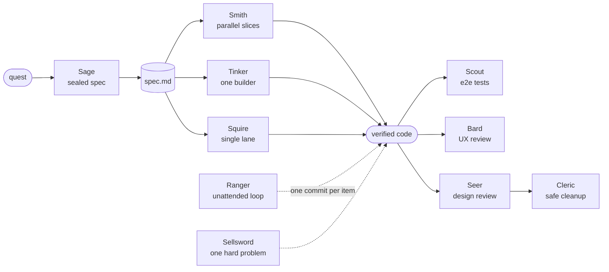

<div align="center">


[](https://github.com/gshepptech/the-tavern/actions/workflows/ci.yml)
[](LICENSE)
[](CONTRIBUTING.md#local-checks-run-these-before-you-push)
[](https://docs.claude.com/en/docs/claude-code)

</div>

# The Tavern

**Hire an AI crew for your quest: fifteen Claude Code plugins that work alone or as a party.**

You walk into the tavern with a job and hire the regular who suits it. The sage writes the plan down, the smith builds
it, the warden keeps watch over every reply, the sellsword takes the one hard problem nobody else wants.

Under the theme, each plugin targets a specific way Claude Code goes wrong. It cites files it never opened, reports
success before the tests have run, and checks its own work by agreeing with itself. The plugins here answer that with
structure rather than prompting: specs with acceptance criteria that can fail, verifiers that never see the builder's
notes, hooks that block an unsupported claim, and scripts that refuse to mark work done without recorded evidence.
Every plugin works on its own. Hire one, or hire a party.

## Features

- **A sealed plan before any build.** Sage writes numbered requirements with a cited source for each and seals the
  file with a hash; Smith and Tinker refuse a spec that was edited after sealing.
- **Three builders sized to the job.** Smith builds large specs in parallel slices, Tinker builds with one builder and
  a capped number of agent calls, Squire runs a single-lane build, verify and fix loop for small specs.
- **Verification that does not trust the builder.** Verifiers start from the spec, not from what the builder says it
  did, and every verdict carries a `file:line` or a command and its output.
- **Guardrails on ordinary turns.** Warden blocks a reply that cites a `file:line` Claude never read or ends by
  promising work instead of doing it. Monk keeps replies short.
- **Unattended work that cannot publish.** Ranger runs a find, plan, build, verify, commit loop for hours; a
  `PreToolUse` hook denies `git push`, remote changes and PR creation even with permissions bypassed.
- **Reviews that stay reviews.** Seer judges whether a design was deliberate or accreted, Bard uses the running app as
  named personas, and Scribe checks docs against the code. Seer and Bard only report; Scribe writes docs, never code.
- **Tested helpers.** The deterministic parts (spec validation, the build ledger, the git guard, the citation check,
  the hooks) are dependency-free Python with their own test suites, run in CI.

## Quick start

Add the marketplace once, then hire who you need. No plugin depends on another.

```
/plugin marketplace add gshepptech/the-tavern
/plugin install sage@the-tavern
/plugin install smith@the-tavern
```

Write the plan, then build it:

```
/sage:plan let shop admins export the orders table as CSV
/smith:build
```

`/smith:build` with no argument picks up the spec Sage sealed most recently. Every plugin's README has its own setup
and commands, so you never need this page to use one.

## The roster

| Regular | Role | What it does | Version |
|---|---|---|---|
| **[Sage](plugins/sage/README.md)** | Plans the quest | Reads the codebase, asks only what the code cannot answer, and writes a sealed spec with requirements that can fail | `v1.0.0` |
| **[Smith](plugins/smith/README.md)** | Builds large specs | Splits a spec into slices, builds them in parallel, and has independent verifiers check every requirement against a ledger of evidence | `v1.0.0` |
| **[Tinker](plugins/tinker/README.md)** | Builds lean | One builder, a code check beside a spec-to-code check, at most two fix rounds and a capped number of agent calls | `v0.1.0` |
| **[Squire](plugins/squire/README.md)** | Builds small specs | A single-lane build, verify and fix loop with a spec-only verifier and drift checks in code | `v1.0.0` |
| **[Sellsword](plugins/sellsword/README.md)** | Owns one hard problem | Five agents investigate, plan, execute and verify across code, servers and infrastructure; an auditor and a fresh-eyes check must both pass | `v0.4.0` |
| **[Ranger](plugins/ranger/README.md)** | Patrols unattended | Finds work, plans, builds, verifies and commits locally, one item per cycle, until you stop it | `v0.7.1` |
| **[Warden](plugins/warden/README.md)** | Keeps watch | Hooks that inject a checklist before each reply and block replies that cite unread files or claim unverified results | `v0.5.1` |
| **[Seer](plugins/seer/README.md)** | Reviews architecture | Eight blind design lenses, each finding cross-examined, then a reshaping plan. Report only | `v0.2.0` |
| **[Cleric](plugins/cleric/README.md)** | Cleans up carefully | Seven cleanup tracks; auto-applies only high-confidence, low-risk changes, one revertable commit per batch | `v0.2.1` |
| **[Scout](plugins/scout/README.md)** | Writes e2e tests | Drives the real app in a browser and writes Playwright specs that pass, then triages failures from traces | `v0.2.1` |
| **[Bard](plugins/bard/README.md)** | Reviews UX | Uses the running app as named personas in a real browser and writes a ranked report with a screenshot behind every finding | `v1.0.0` |
| **[Tactician](plugins/tactician/README.md)** | Plans orchestration | Generates a validated multi-agent Workflow script with the right fan-out shape for the task | `v0.2.1` |
| **[Scribe](plugins/scribe/README.md)** | Writes the docs | Plans, writes and audits documentation, with every claim anchored to a `file:line` or a command that was run | `v1.0.0` |
| **[Raven](plugins/raven/README.md)** | Carries messages | Posts to Slack when a session finishes a reply or is waiting for you, with secrets redacted | `v1.0.0` |
| **[Monk](plugins/monk/README.md)** | Keeps it brief | Seven response-shaping rules and an optional length gate that sends an over-budget reply back once | `v1.0.0` |

## Which regular do I hire?

| If you want to | Hire | Pairs with |
|---|---|---|
| Turn a vague idea into a buildable spec | Sage | Smith, Tinker or Squire |
| Build a large spec, verified requirement by requirement | Smith | Sage, Scout |
| Build a medium spec with a fixed agent budget | Tinker | Sage |
| Build a small spec of up to about fifteen requirements | Squire | Sage |
| Hand off one hard problem that crosses into servers or deploy config | Sellsword | Warden, Monk |
| Keep improving a codebase while you are away | Ranger | Raven, Cleric, Seer, Scout |
| Keep Claude grounded on everyday work | Warden | anything |
| Find out whether a design is deliberate or accreted | Seer | Cleric |
| Clean up a codebase safely | Cleric | Seer |
| Write and maintain browser tests | Scout | Smith, Tinker |
| See where real users would get stuck in your app | Bard | Scout |
| Generate a custom multi-agent Workflow script | Tactician | none |
| Write or audit documentation for your app | Scribe | none |
| Get a Slack message when a session needs you | Raven | Ranger, Sellsword |
| Get shorter replies | Monk | anything |

## How a party works together



- **Sage, then a builder.** Sage's sealed spec is the handoff. Smith builds it in parallel slices with file ownership
  and fixes until every requirement has passing evidence. Tinker does the same job with one builder, and Squire with
  one lane and no planning step. Pick the builder by the size of the spec.
- **Ranger** finds its own work, sizes the effort to each item, and commits one item at a time until you stop it.
  When Cleric, Seer or Scout are installed, its scouts hand them the work in their specialty.
- **Sellsword** takes one hard problem, often one that reaches past the repo, and does not stop until two independent
  verifiers pass.
- **Warden and Monk** sit under everything else. They change how each turn behaves rather than adding a step. Raven
  tells you in Slack when a session is done or waiting.
- **Scout, Bard, Seer, Cleric, Tactician and Scribe** are standalone tools for tests, UX, design, cleanup, Workflow
  scripts and docs.

### The quest board

Regulars with something to share pin notes for each other in an optional `.questboard/` directory at the project root.
Sage pins the spec it sealed, Smith reads it and pins how the build went, Ranger reads every note and pins each attempt,
and Sellsword, Cleric and Seer pin findings they deliberately did not act on. Every plugin behaves the same when the
board is absent. See [the quest board contract](docs/questboard-contract.md).

## Install profiles

If you would rather not choose yet, install a named party from a clone:

```bash
git clone https://github.com/gshepptech/the-tavern && cd the-tavern
./scripts/install-profile.sh builder
```

| Profile | Plugins | For |
|---|---|---|
| `builder` | sage, smith, warden | Specifying a feature and having it built out and verified |
| `lean` | sage, tinker, squire | The same pipeline with fewer agents |
| `solo` | sellsword, warden, monk | One hard problem, owned end to end. `/sellsword:goal` bypasses permissions |
| `review` | seer, cleric, bard | Assessing structure, tidying code and testing the UX |
| `unattended` | sellsword, ranger, raven | Work that runs while you are away. Bypasses permissions |
| `full` | all fifteen | Every regular in the tavern |

`--list` shows each profile, `--dry-run` prints the commands and runs nothing, and `--scope project` writes a committed
`.claude/settings.json`. A profile is a convention of this repo, not a Claude Code feature: it expands to ordinary
`claude plugin install` calls. [docs/profiles.md](docs/profiles.md) covers each one and what it costs.

### What you are installing

> [!WARNING]
> - **Some hooks run on every turn.** Warden and Monk install hooks that run in every project for as long as they are
>   installed, and Raven posts on every finished reply once a webhook is set. Ranger and Sellsword install hooks that are
>   active only while a run is armed.
> - **Unattended modes bypass permission prompts.** Ranger's headless runner and `/sellsword:goal` run without a human to
>   answer prompts. Ranger's git guard still blocks publishing, but only git is guarded, and Sellsword can reach real hosts
>   over SSH. Run those modes in a container, a VM or a throwaway clone.
> - **They spawn subagents.** Each plugin's README says what a run costs and which flags bound it.

## Development

The repo is Markdown (commands, agents, skills), Python helpers and a few Workflow scripts. CI runs the same checks you
can run locally:

```bash
python3 .github/scripts/validate_manifests.py   # manifests and marketplace agree
python3 .github/scripts/check_versions.py       # plugin.json, marketplace, badges, roster table
python3 .github/scripts/check_docs.py           # no decorative Unicode, relative links resolve
python3 .github/scripts/check_flags.py          # documented flags and agent types exist
python3 .github/scripts/check_profiles.py       # install profiles match their docs
python3 .github/scripts/check_js.py             # JavaScript and Workflow scripts parse

for p in sage smith tinker squire ranger warden bard scribe raven monk; do
  (cd plugins/$p && uv run --with pytest python -m pytest -q)
done
```

<div align="center">


</div>

See [CONTRIBUTING.md](CONTRIBUTING.md) for the repo layout, versioning rules and how to add a plugin, and
[SECURITY.md](SECURITY.md) to report a vulnerability. Changes are recorded in [CHANGELOG.md](CHANGELOG.md).

## License

Apache-2.0. See [LICENSE](LICENSE).
