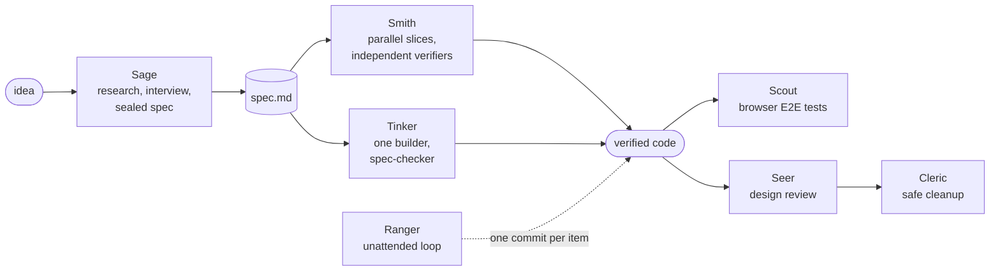

<div align="center">


[](https://github.com/gshepptech/the-tavern/actions/workflows/ci.yml)
[](LICENSE)
[](https://docs.claude.com/en/docs/claude-code)

</div>

# The Tavern

**A Claude Code plugin marketplace of ten independent tools for specifying, building, verifying and maintaining code.**

Claude Code is good at writing code and less reliable at knowing when it is done. It cites files it never opened,
reports success before the tests have run, and checks its own work by agreeing with itself. Each plugin here targets
one of those failure modes with structure rather than prompting: a spec with acceptance criteria that can fail,
verifiers that never see the builder's notes, hooks that block an unsupported claim, and scripts that refuse to mark
work done without recorded evidence. Every plugin works on its own. Install one, or install the set.

## Features

- **Spec to build, with a seal in between.** Sage writes numbered requirements and seals the file with a hash; Smith
  or Tinker refuses to build a spec that was edited after sealing.
- **Independent verification.** Smith's verifiers and Tinker's spec-checker start from the spec, not from what the
  builder says it did, and every verdict carries a command and its output.
- **Guardrails on everyday turns.** Warden's hooks block a reply that cites a `file:line` Claude never read, or that ends
  by promising work instead of doing it.
- **Unattended work that cannot publish.** Ranger runs a find-plan-build-verify-commit loop for hours; a `PreToolUse`
  hook denies `git push`, remote changes and PR creation even with permissions bypassed.
- **Reviews that stay reviews.** Seer reports whether a design is deliberate or accreted and never edits code;
  Cleric auto-applies only high-confidence cleanups, one revertable commit per batch.
- **Plain, testable helpers.** The deterministic parts (spec validation, the build ledger, the git guard, the
  citation check) are dependency-free Python with their own test suites, run in CI.

## Quick start

Add the marketplace once, then install what you need. No plugin depends on another.

```bash
/plugin marketplace add gshepptech/the-tavern
/plugin install sage@the-tavern
/plugin install smith@the-tavern
```

Spec a feature, then build it:

```
/sage:plan let shop admins export the orders table as CSV
/smith:build
```

`/smith:build` with no argument picks up the spec Sage sealed most recently. Every plugin's README has its own setup
and commands, so you never need this page to use one.

## How it works

The crew covers four jobs. Specifying and building are a pipeline; the rest run on their own or alongside.



- **Sage then Smith or Tinker.** Sage's spec is the handoff. Smith splits it into slices with file ownership, builds
  them in parallel and fixes until every requirement has passing evidence. Tinker does the same job with one builder
  and at most two fix rounds, for features one agent can carry.
- **Ranger** finds its own work, sizes the effort to the item, and commits one item at a time until you stop it.
- **Sellsword** takes one hard problem, often one that reaches past the repo into servers or deploy config, and does not
  stop until two independent verifiers pass.
- **Warden** sits under everything else. It changes how each ad-hoc turn behaves rather than adding a step.
- **Scout, Seer, Cleric and Tactician** are standalone tools for tests, design review, cleanup and Workflow scripts.

Plugins that have something to share can leave each other notes in an optional `.questboard/` directory: Sage records the
spec it sealed, Smith and Ranger record what they attempted, and Sellsword, Cleric and Seer record findings they
deliberately did not act on. Every plugin behaves the same when the directory is absent. See
[the .questboard contract](docs/questboard-contract.md).

## The crew

| Plugin | What it does | Commands |
|---|---|---|
| **[Sage](plugins/sage/README.md)** `v1.0.0` | Turns an idea into a sealed spec: reads the code first, asks only what the code cannot answer, writes requirements with criteria that can fail | `/sage:plan`, `/sage:resume` |
| **[Smith](plugins/smith/README.md)** `v1.0.0` | Builds a spec in parallel slices; verifiers that never saw the builders' notes check every requirement, and a ledger refuses "done" without evidence | `/smith:build`, `/smith:status` |
| **[Tinker](plugins/tinker/README.md)** `v0.1.0` | Builds a spec lean: one builder, a code check beside a spec-to-code check, at most two fix rounds, a capped number of agent calls | `/tinker:build` |
| **[Warden](plugins/warden/README.md)** `v0.5.1` | Hooks that inject a measure-twice checklist and block replies that cite unread files, hedge without checking, or promise work instead of doing it | `/warden:status`, `/warden:casual`, `/warden:off` |
| **[Sellsword](plugins/sellsword/README.md)** `v0.4.0` | Five agents that investigate, plan, execute and verify a hard problem across code, servers and infrastructure | `/sellsword:do`, `/sellsword:goal` |
| **[Ranger](plugins/ranger/README.md)** `v0.7.1` | An unattended loop that finds work, plans, builds, verifies with fresh eyes and commits locally, one item at a time | `/ranger:run`, `/ranger:stop` |
| **[Cleric](plugins/cleric/README.md)** `v0.2.1` | Low-risk cleanup across seven tracks (duplication, dead code, weak types, cycles, error handling and more), auto-applying only high-confidence changes | `/cleric:run`, `/cleric:apply` |
| **[Scout](plugins/scout/README.md)** `v0.2.1` | Writes Playwright end-to-end tests by driving the real app in a browser, then triages failures from traces | `/scout:write`, `/scout:crawl`, `/scout:audit` |
| **[Seer](plugins/seer/README.md)** `v0.2.0` | Architecture review: eight blind design lenses, each finding cross-examined, then a reshaping plan. Report only | `/seer:review` |
| **[Tactician](plugins/tactician/README.md)** `v0.2.1` | Generates validated multi-agent Workflow scripts with the right fan-out shape for the task | `/tactician:make` |

### Which one do I need?

| If you want to | Use | Pairs with |
|---|---|---|
| Turn a vague idea into a buildable spec | Sage | Smith or Tinker |
| Build a spec, verified requirement by requirement | Smith | Sage, Scout |
| Build a small spec quickly with few agents | Tinker | Sage |
| Keep Claude grounded on everyday work | Warden | anything |
| Hand off a hard, multi-step problem | Sellsword | Warden |
| Keep improving a codebase while you are away | Ranger | Cleric, Seer, Scout |
| Clean up a codebase safely | Cleric | Seer |
| Write and maintain browser tests | Scout | Smith, Tinker |
| Find out whether a design is deliberate or accreted | Seer | Cleric |
| Generate a custom multi-agent Workflow script | Tactician | none |

### Install profiles

If you would rather not choose yet, install a named set from a clone:

```bash
git clone https://github.com/gshepptech/the-tavern && cd the-tavern
./scripts/install-profile.sh daily
```

| Profile | Plugins | For |
|---|---|---|
| `daily` | warden, sage, cleric | Working solo on a codebase you did not write |
| `pipeline` | sage, smith | Specifying a feature and having it built out |
| `review` | seer, cleric | Assessing and tidying, without autonomous writing |
| `unattended` | sellsword, ranger | Work that runs while you are away. Bypasses permissions |
| `all` | all ten | Everything |

`--list` shows each profile, `--dry-run` prints the commands and runs nothing, and `--scope project` writes a
committed `.claude/settings.json`. A profile is a convention of this repo, not a Claude Code feature: it expands to
ordinary `claude plugin install` calls. [docs/profiles.md](docs/profiles.md) covers each one and what it costs.

### What you are installing

> [!WARNING]
> - **Hooks run on every turn.** Warden installs `UserPromptSubmit` and `Stop` hooks in every project for as long as it
>   is installed. Ranger and Sellsword install hooks that are active only while a run is armed.
> - **Unattended modes bypass permission prompts.** Ranger's headless runner and `/sellsword:goal` run without a human to
>   answer prompts. Ranger's git guard still blocks publishing, but only git is guarded, and Sellsword can reach real hosts
>   over SSH. Run those modes in a container, a VM or a throwaway clone.
> - **They spawn subagents.** Each plugin's README says what a run costs and which flags bound it.

Sage, Smith, Tinker, Cleric, Scout, Tactician and Seer run in your session under your normal permissions.

## Development

The repo is Markdown (commands, agents, skills), Python helpers and two Workflow scripts. CI runs the same checks you
can run locally:

```bash
python3 .github/scripts/validate_manifests.py   # manifests and marketplace agree
python3 .github/scripts/check_versions.py       # plugin.json, marketplace, badges, crew table
python3 .github/scripts/check_docs.py           # no decorative Unicode, relative links resolve
python3 .github/scripts/check_flags.py          # documented flags and agent types exist
python3 .github/scripts/check_profiles.py       # install profiles match their docs
python3 .github/scripts/check_js.py             # JavaScript and Workflow scripts parse

for p in warden sage ranger smith tinker; do
  (cd plugins/$p && uv run --with pytest python -m pytest -q)
done
```

<div align="center">


</div>

See [CONTRIBUTING.md](CONTRIBUTING.md) for the repo layout, versioning rules and how to add a plugin, and
[SECURITY.md](SECURITY.md) to report a vulnerability. Changes are recorded in [CHANGELOG.md](CHANGELOG.md).

## License

Apache-2.0. See [LICENSE](LICENSE).
