<div align="center">


# Ranger

**The foreman who never leaves the site. One prompt, then walk away.**

[](.claude-plugin/plugin.json)
[](../../LICENSE)
[](https://docs.claude.com/en/docs/claude-code)

</div>

> [!NOTE]
> **Ranger stands entirely on its own.** Install it by itself and it runs a full senior-engineering loop — survey, plan, build, verify, commit — with no other plugin present. If `cleric`, `seer`, or `scout` also happen to be installed, a scout will dispatch to them for their specialisms instead of duplicating that work; none of them is required, and Ranger covers the same ground itself if they're absent.

---

## When to use it

| Reach for it when | Don't bother when |
|---|---|
| You have hours you won't be at the keyboard and a codebase worth a standing quality sweep | **You have a specific task in mind.** A direct prompt is faster, cheaper and better aimed — Ranger surveys, and a survey is wasted when you already know the answer |
| The project has tests, a linter or a build the assessor can actually run | **There are no tests and nothing to check against.** Verification degrades to reading the diff, and a loop you can't verify is a loop you can't leave |
| You're under version control and happy with one local commit per item | **You're not in a git repo.** Ranger refuses to start — one commit per item *is* the undo, and without git there isn't one |
| You want breadth — accessibility, polish, performance, real-user flows — swept in rotation rather than chosen | You want one feature built to a spec. Ranger biases toward what already exists; a brief tilts its ranking, it doesn't hand it a backlog |

---

## What it does

Most "autonomous" loops die one of two deaths: they run out of work and stop, or they fill their context window and go stupid. Ranger is built against both.

- **No exit condition.** An empty backlog is a survey trigger, not a finish line. Continuous operation is a *driver's* job — `/loop /ranger:run` while you watch (Esc to stop), or a headless runner overnight. Each `/ranger:run` does one clean cycle and returns; nothing traps the turn.
- **A thin lead.** The foreman reads state files and spawns agents. He never opens a source file. Every agent gets a fresh context; his own window stays small, so a run survives for hours.
- **A crew, not a queue.** Surveying, planning and plan-review are read-only, so they run as parallel pools. Only the build touches the shared tree, so only the build is serial — one item at a time.
- **Plan review before code.** A rejected plan costs one agent; a bad implementation costs five.
- **Fresh-eyes verification.** The assessor never sees the plan — only the acceptance criteria and the code. It cannot be argued into agreeing. UI items get driven through a real browser, clicked through like a user would.
- **Local commits only.** `git push` is denied by a `PreToolUse` hook for the whole run, and no flag turns it on.

---

## Install

**1. Install**

```bash
claude plugin marketplace add gshepptech/the-tavern
claude plugin install ranger@the-tavern
```

*(Already installed? `claude plugin marketplace update the-tavern` to get the latest.)*

**2. Preview — changes nothing**

```
/ranger:run make the dashboard genuinely good --dry-run
```

The recommended first contact: you get the ranked backlog and the plan for the top item, and nothing is written. [Worked example 1](#worked-examples) shows what comes back.

**3. Set him going** — `/loop /ranger:run make the dashboard genuinely good`, and press **Esc** to stop.

> [!WARNING]
> **Read this before step 3, not after.** Two things about a real run:
>
> - **It is uncapped by default.** Ranger works until you stop him — `/ranger:stop`, Esc out of the loop, or kill the runner. Nothing else ends it. `--max-hours=N` is the only bound that stops a run on its own. (`--max-cycles=N` counts *shipped* items, so a run that keeps reverting never reaches it.)
> - **Unattended mode runs with permissions bypassed.** With no human present to answer prompts, the headless runner and every agent it spawns execute tools without asking: file writes, shell commands, network calls. The git guard still holds, but **only git is guarded**. Run the headless mode in a container, a VM, or a throwaway clone — never on a machine you care about while you walk away. The watched `/loop` form is lower-risk only because you are sitting there.

If you run a methodical-mode plugin (`warden`, `adhoc`, `plumb`), clear its strict gate first — `/warden:strict-off` etc. — or it will deadlock the loop. Ranger checks this at the start and tells you exactly what to run.

---

## The cycle

Ranger's whole story is its loop: a read-only crew fans out in parallel, then one thread of work goes serial through the tree.

```mermaid
flowchart LR
    classDef pool fill:#FFF3C4,stroke:#F9A825,stroke-width:1px,color:#3a2e00;
    classDef serial fill:#F9A825,stroke:#3a2e00,stroke-width:2px,color:#1a1400,font-weight:bold;
    classDef lead fill:none,stroke:#999,stroke-width:1px,stroke-dasharray:3 3;

    subgraph SU["survey - scouts, default 6"]
        direction TB
        s1[scout]:::pool
        s2[scout]:::pool
    end
    subgraph PL["plan - planners, default 3"]
        direction TB
        p1[planner]:::pool
        p2[planner]:::pool
    end
    subgraph PR["plan-review - planners"]
        direction TB
        r1[reviewer]:::pool
        r2[reviewer]:::pool
    end

    SU --> PL --> PR --> SEL[select]:::lead
    SEL --> BUILD[build — implementer]:::serial
    BUILD --> DIFF[review — diff]:::lead
    DIFF --> VER[verify — assessor]:::lead
    VER --> COM[commit]:::lead
    COM -.refills backlog above watermark.-> SU
```



| step | who | what |
|---|---|---|
| **survey** | *N* scouts in parallel | one domain/lens pair each — refills the backlog *before* it runs low |
| **plan** | *M* planners in parallel | each reads what exists, hunts for reuse, writes the smallest correct plan |
| **plan-review** | *M* reviewers in parallel | approve, revise, split, or drop — before a line of code exists |
| **select** | lead | takes the highest-scoring already-approved plan |
| **build** | 1 implementer — serial | the only step that touches the shared tree |
| **review** | reviewer | correctness, regression, reuse, altitude, honesty — against the real diff |
| **verify** | assessor | fresh eyes, evidence ledger, real browser for UI items |
| **commit** | lead | one local commit, one journal line, back to survey |

Reviewer **and** assessor must both return `pass`. Anything else revises, and after two rounds the item is reverted — never patched over.

---

## Why it never runs out of work

The first survey sends one scout to map the *product* — its real domains, like the checkout flow, the settings page, the CLI, the auth layer. After that the foreman crosses those domains with nine lenses:

**correctness, UI/UX, visual polish, real-user flows, performance, accessibility, security, DX, feature gaps** — swept in that order.

Every domain/lens combination is a **pair**, and each scout in a wave takes one; a persistent `swept` map means no pair is issued twice, so the loop moves forward instead of circling. The survey fires when the backlog drops **below a watermark** (default `scouts + 2` = 8 items), not when it hits zero — so the foreman is stocking up while the current item is still being built, and never stalls waiting for work.

**It will not manufacture churn.** Every candidate is scored `value + confidence - effort`; anything under 6 is dropped. A scout that finds nothing above the floor reports its pair **clean** — a real, useful answer. Keeping the backlog full is the foreman's job, answered by dispatching more pairs, never by pressing a scout to come back with something.

---

## Commands & flags

| command | what it does |
|---|---|
| `/ranger:run <brief> [flags]` | Run one cycle — survey, plan, review, build, verify, commit one item — and return. |
| `/ranger:resume [run-id] [--max-cycles=N] [--max-hours=N] [--unlimited]` | Pick a stopped run back up: same backlog, rotation, and flags. |
| `/ranger:stop [run-id]` | Down tools — the only clean way to end a run. |
| `/ranger:status` | Read-only — what he's working on right now. Safe mid-run. |
| `/ranger:help` | Explains the loop and every flag, in chat. |

| flag | default | with the flag |
|---|---|---|
| `--preset <name>` | sweeps every domain in rotation | focuses one curated checklist: `ui`, `ux`, `a11y`, `harden`, `perf` |
| `--dry-run` | executes for real | previews only — one scout + top plan, no writes, no commit |
| `--scouts=N` | 6 sweep in parallel | resize the survey team (clamped 1–8) |
| `--planners=N` | 3 plan (and 3 review) in parallel | resize the plan pool (clamped 1–4) |
| `--branch` | commits to the current branch | a local branch per item |
| `--merge-dev` | leaves integration to you | merges verified items into `dev` |
| `--ask` | **never asks you anything** | may ask when genuinely blocked |
| `--max-cycles=N` | **unlimited** | stands down after N *shipped* items (`0` = unlimited) |
| `--max-hours=N` | **unlimited** | stands down after N hours (`0` = unlimited) |
| `--unlimited` | — | no-op — kept so older invocations don't error |
| `--new` | continues a parked run | forces a fresh run |

Note `--max-cycles` counts **shipped items**, not attempts — a cycle that reverts, quarantines, or finds nothing above the quality floor spends time without advancing the count. That makes **`--max-hours` the only cap that reliably bounds spend.**

There is no `--push` and no flag that adds one. A `PreToolUse` hook (`scripts/guard-git.py`) denies `git push`, remote mutation (`git remote add/set-url/…`, `git config remote.*`), `git send-email`, PR/release creation (`gh pr create`, `gh release create`) and `gh api` calls that use a write method — for the entire run, with nothing to enable them. Branch creation and merges are allowed only with `--branch` / `--merge-dev`; everything else about git is untouched. Because it runs outside the model, the block holds even under bypassed permissions, and it resolves shell quoting and looks inside `sh -c`, `bash -c` and `eval` wrappers, so the obvious ways past it are closed.

> [!IMPORTANT]
> **It is a guardrail, not a sandbox.** The guard inspects commands as text, and its threat model is an agent publishing by accident — not someone deliberately working around it. A command that writes a script and then runs it, or reaches the network by a route nobody enumerated, gets through. The real containment for an unattended run is running it somewhere disposable. Anyone telling you a text-matching hook is airtight is selling something.

### Presets

`--preset <name>` swaps the broad domain rotation for a curated checklist, skipping any item that doesn't apply to your app instead of inventing the missing feature:

| preset | what it works on |
|---|---|
| `ui` | visual polish — hierarchy, spacing rhythm, type, colour, empty/loading/error states |
| `ux` | real-user flows — drives the app, checks the primary task completes, errors recover |
| `a11y` | keyboard traversal, focus, semantics, names/labels, contrast, reduced motion |
| `harden` | input validation, injection, authz, secrets, error hygiene, dependencies |
| `perf` | N+1s, over-fetching, bundle weight, render cost, blocking work — evidence required |

---

## Worked examples

Output below is **illustrative** — the preview block, the per-cycle line and the stand-down debrief are abbreviated from the templates in `commands/run.md`. Titles and shas are made up; the shapes are not.

<details>
<summary><b>1. Preview before you spend anything</b> — <code>--dry-run</code></summary>

You've just installed it and want to know what it would actually do to your app.

```
/ranger:run make the dashboard genuinely good --dry-run
```

```markdown
**Ranger dry run — preview only, nothing changed.**

**What I'd work on (top of a 7-item backlog):**
1. [8] Dashboard empty state is a bare "No data" string — dashboard/ui-ux
2. [7] Chart re-renders on every poll tick — dashboard/performance
3. [7] Date-range picker cannot be reached by keyboard — dashboard/a11y

**Plan for #1 — Dashboard empty state is a bare "No data" string**
Reuse the EmptyState component the reports page already has rather than adding a
second one; pass the dashboard's copy and primary action through its props. 2 files.
· reviewer verdict: approve

**Domains I'd rotate through:** dashboard, settings, auth, billing, CLI

Run without --dry-run to execute. A real run is uncapped — it works until you stop it.
Pass --max-cycles=N or --max-hours=N to bound it.
```

A dry run spends one scout, one planner and one plan reviewer, and writes nothing but its own state directory. **Next:** if the top of that backlog is work you'd have done yourself, drop `--dry-run`; if it isn't, sharpen the brief and preview again — that's the cheap loop.
</details>

<details>
<summary><b>2. A bounded run you watch</b> — <code>/loop</code> plus <code>--max-hours</code></summary>

An afternoon free, and you want the dashboard genuinely improved rather than one specific fix.

```
/loop /ranger:run make the dashboard genuinely good --max-hours=3
```

```markdown
Ranger is on site — ranger-20260722-093015-1f4a.  Brief: make the dashboard genuinely good  Cap: 3h.
Local commits on main. Keep me working: /loop /ranger:run …  (Esc to stop)

✓ 1. Dashboard empty state reuses EmptyState — 4f2a1c9  ·  6 queued, 2 planned
✓ 2. Debounce poll tick, memoise chart series — 91be07d  ·  5 queued, 3 planned
· nothing above the floor in dashboard/security, settings/security; rotating on
✓ 3. Date-range picker reachable and focus-visible — c30ff41  ·  8 queued, 2 planned

**Ranger stood down** — ranger-20260722-093015-1f4a · 3 items · 3h04m · (capped, user)

**Shipped** — 4f2a1c9 empty state · 91be07d chart re-render · c30ff41 date-picker keyboard
**Left on the backlog** — 5 ready items, top: "Settings save gives no confirmation"
**Quarantined** — none

Continue: /ranger:resume ranger-20260722-093015-1f4a --max-cycles=0  ·  Artifacts: .ranger/runs/ranger-20260722-093015-1f4a/
```

One line per cycle is the whole chat output — the detail lives in `journal.md` and `items/<id>/`. **Next:** read the three commits. Each is one item, so anything you disagree with is one `git revert` away.
</details>

<details>
<summary><b>3. One lens, not the whole rotation</b> — <code>--preset</code></summary>

An accessibility audit is coming and you want the obvious failures gone first.

```
/ranger:run get the checkout flow to WCAG AA --preset a11y --scouts=4 --max-hours=2
```

The preset swaps the broad domain rotation for the `a11y` checklist; the brief still biases ranking, so checkout work sorts above everything else.

```markdown
✓ 1. Focus trap in the payment modal, Esc now closes — 7ab4e10  ·  4 queued, 2 planned
✓ 2. Card fields get labels and error announcements — e59c2d3  ·  3 queued, 3 planned
```

**Next:** re-run with `--preset ui` once the a11y sweep quietens, or drop the preset and let the full rotation carry on.
</details>

---

## Keeping it running

Each `/ranger:run` does **one cycle and returns** — a clean turn, no hook trapping the session. Driving it is your choice: `/loop /ranger:run <brief>` keeps it going in your session (Esc to stop), or run it overnight with a fresh `claude -p` process per cycle, so context never accumulates:

```bash
# from the root of the repo you want worked on.
# The plugin cache keeps one directory per installed version, so resolve to the
# newest rather than globbing — an unquoted glob that matches two versions runs
# the older one and silently folds the other path into your brief.
RANGER=$(ls -d ~/.claude/plugins/cache/the-tavern/ranger/*/scripts/ranger-run.sh | sort -V | tail -1)
"$RANGER" "make the dashboard genuinely good"
```

`/ranger:stop` from any session ends a run; `/ranger:resume` picks it back up.

> [!WARNING]
> **Run unattended mode in a sandbox.** With no human present to answer permission prompts, Ranger runs with permissions bypassed — the `ranger-run.sh` runner and every agent it spawns execute tools without asking. The guard hook blocks `git push`, remote mutation and PR creation even in bypass mode — but **only git is guarded. Everything else runs unprompted**: file writes, shell commands, network calls. That is the cost of an unattended loop, not a defect.
>
> Run overnight/headless mode somewhere a bad command can't hurt you — a container, a VM, or a throwaway clone. Do **not** point it at a machine you care about and walk away. The watched `/loop /ranger:run` is lower-risk because you're right there, but it bypasses prompts too.

---

## Guardrails

| risk | guard |
|---|---|
| publishing unattended | the `PreToolUse` hook denies `git push`, remote mutation, `gh pr`/`release` creation — always, even under bypassed permissions |
| scope creep | an item past ~12 files / ~600 lines unplanned is stashed and split |
| grinding on the impossible | 3 cycles with no commit, and the item is quarantined; rotation advances |
| a bad change compounding | revert, don't pile on — one commit per item, one `git revert` away |
| conflicts | a conflicting merge is aborted and left on its branch, never resolved unattended |
| interactive deadlock | preflight refuses to start unless the methodical-mode strict gates (`warden`, `adhoc`, `plumb`) are off |

---

## Where state lives

```
.ranger/
  active-run.json          the marker that arms the guard hook — {} when idle
  runs/<run-id>/
    state.json             status, phase, cycle, flags, crew sizes, domain rotation
    backlog.json           ranked items: ready / planned / approved / in_flight / done / quarantined
    journal.md             one line per shipped item, with sha
    items/<item-id>/       plan.md, build.md, verify.md, screenshots
```

All of it is on disk, not in the context window — a compaction mid-run is survivable, and `/ranger:run` picks up exactly where a stopped run left off.

---

## What it costs

Every cycle is a crew, and the crew is subagents. At full stretch one cycle dispatches **6 scouts, then 3 planners, then 3 plan reviewers, then 1 implementer, 1 diff reviewer and 1 assessor** — fifteen agents, each with its own context window, to produce one commit. Cycles are cheaper when the pipeline is already stocked: the survey is skipped while the backlog sits above the watermark, and the plan pool is skipped while approved plans are queued. Cycles are dearer when work doesn't land — a revised plan, a rejected diff or a failed verification all spend agents without producing a commit. `--scouts=N` and `--planners=N` are the two dials on the per-cycle width.

And it does not stop on its own. **Uncapped is the default**: `/ranger:stop`, Esc, or killing the runner are the only things that end a run. `--max-cycles=N` counts *shipped* items, so a run that keeps reverting spends indefinitely without ever reaching the cap — **`--max-hours=N` is the only bound that terminates a run by itself.** Set one on your first unattended run.

Watch the first few cycles before trusting it overnight; the attended-to-unattended transition is the whole skill. And Ranger is deliberately conservative about what counts as work — if you want him building features rather than sweeping domains, say so in the brief. It biases the scout's ranking; it doesn't limit scope.

---

## Pairs well with

Ranger needs none of these — each is a standalone plugin you can install with or without it:

- **[Cleric](../cleric/README.md)** — if installed, a scout on the `dx` lens dispatches dedup/dead-code/type-consolidation findings to it instead of duplicating the sweep.
- **[Seer](../seer/README.md)** — same `dx` lens, for macro-architecture and design-cohesion findings.
- **[Scout](../scout/README.md)** — a scout on the `flows` lens dispatches to it for end-to-end browser coverage.

---

<div align="center">

Apache-2.0 — see [LICENSE](../../LICENSE). © 2026 gshepptech

</div>
