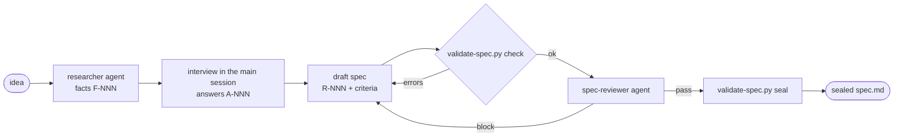

# Sage

**Sage draws the plans.** It turns a feature idea into a sealed spec that someone else can build without coming back
to ask what you meant.

[](.claude-plugin/plugin.json)
[](../../LICENSE)
[](scripts/validate-spec.py)

## What it does

Most specs fail in one of two ways. They ask the author questions the codebase already answers, or they state
requirements nobody can check ("export works correctly"). Sage reads the code before it asks you anything, keeps the
interview to the decisions only you can make, and writes requirements whose acceptance criteria name an observable
result. A small validator then checks the structure and seals the file with a hash, so the spec a builder reads is
the spec you approved.

## Features

- **Code first, questions second.** A researcher agent reports numbered facts (`F-001`), each with `path:line`
  evidence, and a short list of the decisions the code cannot settle.
- **A short, grounded interview.** One question at a time, with options tied to what the code does today. Each answer
  is recorded as `A-001` the moment you give it.
- **Every requirement cites its source.** `R-001` names the answers and facts behind it. A requirement with no source
  does not pass validation.
- **Criteria that can fail.** Each requirement lists checks with an input, an action and an observable result. The
  validator refuses words like "correctly" and "gracefully".
- **An adversarial review before sealing.** A reviewer reads your answers and the code facts before the spec, then
  flags anything a builder could read two ways.
- **A seal that shows edits.** Sealing records a sha256 of the spec. `verify-seal` fails on any later change.
- **Resumable.** The phase is read from the files on disk, so `/sage:resume` picks up where a session ended.

## Quick start

```bash
claude plugin marketplace add gshepptech/the-tavern
claude plugin install sage@the-tavern
```

Then, in a project:

```
/sage:plan let shop admins export the orders table as CSV
```

The sealed spec lands in `sage-specs/<slug>/spec.md`. Build it with [Smith](../smith/README.md):
`/smith:build sage-specs/<slug>/spec.md`.

## How it works



The interview runs in your session rather than in a subagent, because a subagent cannot ask you questions. The
researcher and the reviewer are subagents so their file reading stays out of your context.

The validator is plain Python with no dependencies. The seal it writes is one frontmatter line:

```
sealed_by: validate-spec.py sha256:<hex>
```

The hash covers the whole file with that line removed. [Tinker](../tinker/README.md) checks the same seal before it
builds.

## Reference

### Commands

| Command | What it does |
|---|---|
| `/sage:plan <idea>` | Research, interview, draft, review and seal a new spec |
| `/sage:resume [slug]` | Continue an unsealed spec from the phase its files show |
| `/sage:help` | A short summary of the above |

### The spec format

[`templates/spec.md`](templates/spec.md) is a complete, valid example. The parts the validator reads:

| Part | Rule |
|---|---|
| Frontmatter | `title` and `status` (`draft` or `sealed`) |
| `## Requirements` | `### R-NNN: title` blocks: a statement, a `Source:` line, an `Acceptance:` list |
| `## Non-goals` | at least one bullet |
| `## Open questions` | optional; only `- None` when sealing |
| `## Appendix: Interview Transcript` | `### A-NNN` answers |
| `## Appendix: Codebase Facts` | `### F-NNN` facts, each with `path:line` evidence |

Checks that fail a spec: missing sections, duplicate IDs, a requirement with no statement, source or criteria, a
citation that no appendix defines, a fact with no evidence, a vague or too-short criterion, a `TODO`/`TBD` outside
the appendices, an open question, and `status: sealed` without a valid seal. Facts or answers that no requirement
cites are warnings.

### The script

```bash
bash plugins/sage/scripts/sage check spec.md          # JSON report; exit 1 on errors
bash plugins/sage/scripts/sage hash spec.md           # the content hash
bash plugins/sage/scripts/sage seal spec.md --review review.json
bash plugins/sage/scripts/sage verify-seal spec.md
bash plugins/sage/scripts/sage status sage-specs/<slug>
```

`seal --review` refuses unless the review says `pass` and was written for this exact draft.

### Files

```
sage-specs/<slug>/
  research.md     facts from the code
  interview.md    your answers, in order
  spec.md         the spec
  review.json     the reviewer's verdict and flags
```

## Shared workspace (optional)

When a spec seals, Sage writes one `spec` note to `.questboard/notes/` pointing at it, so Smith can find the newest spec
without being told the path. Sage reads nothing from the workspace and behaves the same when `.questboard/` is absent.
See [the contract](../../docs/questboard-contract.md).

## Development

```bash
cd plugins/sage
uv run --with pytest python -m pytest -q
```

The tests cover every validator rule against the shipped template, the seal and its interaction with Tinker's seal
check, the phase report used by `/sage:resume`, and the shared-workspace helper.

## License

Apache-2.0. See [LICENSE](../../LICENSE).
