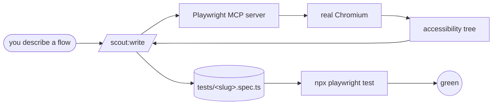

<div align="center">


# Scout

**Describe the flow. Scout drives it in a real browser and writes the Playwright spec.**

[](.claude-plugin/plugin.json)
[](../../LICENSE)
[](https://docs.claude.com/en/docs/claude-code)

</div>

*The scout walks every path through your app in a real browser and writes down how to walk it again.*

> End-to-end test authoring and maintenance for web apps. Claude opens a real browser via Playwright MCP, reads the accessibility tree, performs the clicks itself, and emits a passing `*.spec.ts` — then keeps it passing.

> [!TIP]
> **Scout is standalone.** Install it on its own, point it at any web app with a `playwright.config.ts` and a running dev server, and it will scaffold, author, and maintain a real E2E suite. It doesn't need any other plugin from The Tavern.

---

## When to use it

| Reach for it when | Don't bother when |
|---|---|
| A user-facing flow needs covering and you'd rather describe it than hand-write selectors | You want unit tests. Vitest and Jest are the right tool and they don't need a browser |
| You've got no E2E coverage at all and want a smoke baseline across every route in an afternoon | There's no running app to drive. Every browser command needs a reachable `baseURL`; Scout never starts your dev server |
| The suite has gone red and you want failures triaged by root cause, not a list of red lines | The page is still being redesigned. Coverage written against a shape that changes next week is coverage you rewrite next week |
| Access control matters and you want every route checked against every role | You're testing an API contract, measuring load, or driving something that isn't a browser — a native app, a CLI, a background job |

---

## Why drive the real app

Writing E2E tests is tedious in a specific way: you click around the app yourself, hand-write selectors, watch them break the day someone renames a button, then do it all again. Scout does the clicking. Tell it a flow in plain English, get back a spec that passes now and has a fighting chance of still passing next month.

The trick is the **accessibility tree**. Every `browser_snapshot` Scout takes returns the same role + accessible-name structure Playwright itself uses at runtime — what Claude sees while authoring is what the test will see while running, so selectors don't drift between the two.

---

## Install

```bash
claude plugin marketplace add gshepptech/the-tavern
claude plugin install scout@the-tavern
```

Then, from inside the project you actually want to test — not this marketplace repo, Scout refuses to set itself up against it:

```bash
/scout:init
```

> [!IMPORTANT]
> **Four things must be true before any browser-driving command works, in this order.** Getting this wrong is the most confusing failure Scout has: the command starts, the MCP tools aren't there, and it stops with nothing useful done.
>
> 1. **`@playwright/test` installed and browsers downloaded.** `/scout:init` runs `npm install --save-dev @playwright/test` then `npx playwright install` — the browser download is several hundred MB and takes a minute.
> 2. **Playwright MCP registered in `.mcp.json`.** `/scout:init` writes or merges the `playwright` server entry. Existing entries are preserved, never clobbered.
> 3. **Restart Claude Code.** MCP tools (`browser_navigate`, `browser_snapshot`, `browser_click`, …) only load at startup. Skip this and `/scout:write` and `/scout:crawl` have nothing to drive — both preflight for the tools and stop if they're missing.
> 4. **Start your dev server.** Every browser command needs a reachable `baseURL` (from `playwright.config.ts`, default `http://localhost:3000`). Scout checks it with `curl -sI` and will not start it for you.
>
> `/scout:init` also refuses to overwrite an existing `playwright.config.ts` without your explicit acknowledgement.

Once all four are done:

```bash
/scout:write "user signs up with email, verifies the magic link, lands on the dashboard"
/scout:crawl        # bulk smoke coverage across every route
/scout:audit        # run the suite, triage anything red
```

---

## What it checks

| Command | When to run | What it does |
|---|---|---|
| `/scout:init` | Once per project | Installs Playwright, downloads browsers, writes `playwright.config.ts`, registers the Playwright MCP server, scaffolds `tests/` |
| `/scout:write "<flow>"` | Each new feature/flow | Drives the browser via MCP, emits `tests/<slug>.spec.ts`, runs it green (retries up to 4 times) |
| `/scout:crawl [baseURL]` | Once, for a baseline | Finds every route by reading the router config *and* a live BFS crawl, emits one 3-assertion smoke spec per route |
| `/scout:matrix` | Once access control matters | Builds a routes-by-roles suite; logs each role in once and reuses `storageState` |
| `/scout:audit [--fix]` | After changes, pre-merge | Runs the suite, opens `trace.zip` per failure, classifies by root cause; `--fix` proposes patches and stops for your ack before applying |
| `/scout:record <slug>` | Rare — OAuth, 2FA, drag gestures, payments | Wraps `playwright codegen` for manual capture, then tidies the recorded selectors and waits |
| `/scout:help` | Anytime | Full command/skill/subagent reference |

`/scout:crawl` reads the framework's own router — Next.js app/pages router, React Router, Vue Router, SvelteKit, Remix, Astro — then unions that with a live crawl (depth 4, 60-page cap) so routes hidden behind auth or lazy-loading still get caught. `/scout:matrix` builds on that route inventory: it's observation-first, capturing the actual status per (route, role) pair on the first run so you tighten the assertion rather than Scout guessing your access policy.

---

## How it finds it



1. `browser_navigate` to the flow's start URL.
2. `browser_snapshot` returns the accessibility tree — roles, accessible names, structure.
3. Claude picks each element by role + name and calls the matching MCP tool (`browser_click`, `browser_type`, `browser_select`, …).
4. Snapshot again to confirm the DOM changed, and to capture post-state for assertions.
5. Emit the spec, run it, retry up to 4 times on a selector miss or timing issue before stopping to ask.

Multi-step flows (a login plus an action, a cross-page workflow) delegate to the `scout:spec-writer` subagent, so the MCP snapshot noise stays out of the main conversation — you get the flow description in, a pass/fail report back.

---

## Worked examples

Output below is illustrative. The spec follows the template and rules in the `scout:author` skill, the authoring report follows the `scout:spec-writer` return format, and the triage block follows the report shape in `commands/audit.md`. Your accessible names and timings will differ.

### 1. Cover a flow you just built

Signup with a magic link works when you click through it by hand, and you want that locked in before someone renames a button.

```bash
/scout:write "user signs up with email, verifies the magic link, lands on the dashboard"
```

It's a multi-step, cross-page flow, so it goes to the `scout:spec-writer` subagent: navigate, snapshot, click, snapshot, emit, run. What comes back to the conversation is short:

```text
spec path: tests/signup-magic-link-dashboard.spec.ts
result: pass
runtime: 4.2s
retries used: 1
console errors observed during flow: none
notes: the dashboard heading renders after a client-side redirect; first attempt asserted too early, so the assertion now waits on the heading itself
```

And this is the file it wrote:

```ts
import { test, expect } from '@playwright/test';

test.describe('signup', () => {
  test('verifies magic link and reaches dashboard', async ({ page }) => {
    const consoleErrors: string[] = [];
    page.on('console', m => { if (m.type() === 'error') consoleErrors.push(m.text()); });

    await test.step('submit email', async () => {
      await page.goto('/signup');
      await page.getByLabel('Email').fill('user@example.com');
      await page.getByRole('button', { name: 'Send magic link' }).click();
    });

    await test.step('follow the link and land on dashboard', async () => {
      await page.goto('/verify?token=test-token');
      await expect(page.getByRole('heading', { name: 'Welcome' })).toBeVisible();
    });

    expect(consoleErrors).toEqual([]);
  });
});
```

Note what isn't in there: no CSS selectors, no `.click()` on a class name, no `waitForTimeout`. Every element is addressed the way a screen reader would address it, which is also how Playwright resolves it at runtime.

**Next:** commit it, then run `/scout:audit` to confirm the new spec didn't disturb anything else.

### 2. The suite went red overnight

Eleven tests failed on this morning's CI run and the messages are a wall of timeouts.

```bash
/scout:audit
```

Scout runs the suite, opens `test-results/<test>/trace.zip` for each failure, and groups findings by root cause rather than by test:

```text
Audit: 63 tests run, 52 passed, 11 failed in 94s

Failures by class:
  SELECTOR_DRIFT: 8
  CONSOLE_ERROR: 2
  STATE_LEAK: 1

Findings:
  [SELECTOR_DRIFT] tests/login.spec.ts:14 (+7 more) — "Sign in" button renamed to "Log in"
    Root cause: trace DOM shows role=button with accessible name "Log in"; locator expects "Sign in"
    Fix direction: update the locator to the current accessible name in all 8 specs

  [CONSOLE_ERROR] tests/smoke/settings.spec.ts:9 (+1 more) — TypeError reading 'plan' of undefined
    Root cause: page renders, but the console listener caught a real error during initial paint
    Fix direction: product bug, not a test bug — do not suppress the assertion

  [STATE_LEAK] tests/matrix/admin/billing.spec.ts:22 — passes alone, fails in suite
    Root cause: trace shows an already-dismissed onboarding modal on first paint
    Fix direction: isolate via storageState or clear the flag in a fixture

Suggested next: /scout:audit --fix for the selector drift; triage the console error as a product bug
```

Eleven red lines, three real problems — and one of them is a product bug the suite caught rather than a test to repair.

**Next:** run `/scout:audit --fix`, acknowledge the selector patches, and file the console error against the product rather than the suite.

---

## Why the specs hold up

That spec's shape isn't a style preference — it's enforced:

- **Locators:** priority order is `getByRole`, then `getByLabel`, then `getByText`, then `getByTestId`, then CSS last. CSS or XPath only as a last resort, with a comment justifying why nothing above it matched.
- **Waits:** `page.waitForTimeout(ms)` is never written. Auto-wait via `expect(locator).toBeVisible({ timeout })` or `.toHaveText()` instead.
- **Idempotency:** every `test()` sets up its own state and asserts on what the user sees, not internals like `localStorage`. Playwright's default is `fullyParallel: true` — a test that only passes alone is a broken test, not a parallelism problem.

These rules live in the `scout:author` skill and load automatically with `/scout:write`, `/scout:record`, and the spec-writer subagent.

---

## How it keeps it green

`/scout:audit` doesn't stop at pass/fail counts — it reads `test-results/<test>/trace.zip` for every failure and classifies the root cause using the `scout:diagnose` skill:

<details>
<summary>Failure taxonomy (click to expand)</summary>

| Class | Signal | Fix direction |
|---|---|---|
| `SELECTOR_DRIFT` | Element resolves to N elements, or not at all | Re-snapshot, update the locator to the current accessible name |
| `TIMING` | Timeout, but the element shows up in a later snapshot | Swap the wait for `expect(locator).toBeVisible({ timeout })` |
| `ASSERTION_MISMATCH` | Assertion failed, page rendered fine | Surface both readings — intentional change vs. regression — don't silently relax the assertion |
| `CONSOLE_ERROR` | Test's console listener caught a real error | Almost always a genuine product bug |
| `NETWORK_FAIL` | A request failed in the trace's network panel | Mock incidental endpoints; fix or flag the test's actual target |
| `STATE_LEAK` | Passes alone, fails in the full suite | A prior test left state — isolate via `storageState` or fixture cleanup |
| `FLAKY` | Passes on retry | Find the race (animation, debounce, async render); never paper over with `test.retry` |

</details>

Findings with the same root cause are grouped — eight tests failing because one button got renamed is one finding, not eight. With `--fix`, Scout proposes patches for every finding and **stops** for your ack before touching a file.

---

## Files it writes

```
your-project/
├── playwright.config.ts   # from /scout:init
├── .mcp.json               # Playwright MCP entry (headed by default)
├── tests/
│   ├── signup-*.spec.ts   # from /scout:write
│   ├── smoke/             # from /scout:crawl
│   └── matrix/<role>/     # from /scout:matrix
├── test-results/           # run artifacts, gitignored
├── playwright-report/      # HTML report, gitignored
└── .auth/                  # storageState per role, gitignored — never commit session tokens
```

This is for the "did the user-facing flow work" question specifically. It is not for unit tests (Vitest/Jest), API contract tests, or load/performance testing.

---

## What it costs

Scout is the cheapest of the regulars — most of the work happens in your own conversation rather than in a fan-out of subagents — but there are two things that scale:

- **Snapshots.** Every `browser_snapshot` returns a full accessibility tree, and authoring takes one per action. Cost scales with the number of steps in the flow, not with the size of the app.
- **Route and role counts.** `/scout:crawl` emits one spec per discovered route and is bounded by **depth 4 / 60 pages**. `/scout:matrix` covers routes multiplied by roles, logging in once per role and reusing `storageState` — the pair count is what to watch.

`/scout:write` spawns exactly one Opus subagent (`scout:spec-writer`) for a multi-step flow, and does simple single-action flows inline. Authoring retries a failing spec at most **4 times** before stopping to ask. `/scout:init` configures a single Chromium project deliberately — adding Firefox and WebKit triples every run for diminishing return. `--fix` never applies a patch without your acknowledgement.

---

## Pairs well with

Scout stands alone, but if you have hired other regulars from The Tavern:

- **[Smith](../smith/README.md)** or **[Tinker](../tinker/README.md)** — build a feature from a spec, then lock its behaviour in with browser tests.
- **[Ranger](../ranger/README.md)** — hand it the "run `/scout:audit`, keep it green" loop as part of an unattended sweep.
- **[Seer](../seer/README.md)** — architecture review for the app Scout is testing, before Scout writes coverage against a shape that's about to change.

---

## License

Apache-2.0 — see [LICENSE](../../LICENSE). © 2026 gshepptech
