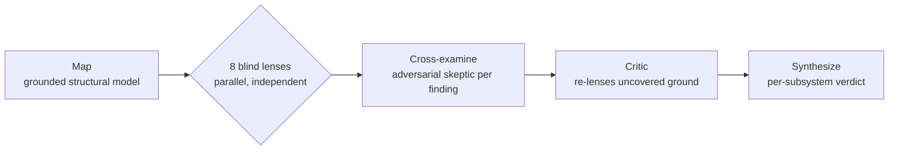

<div align="center">


# Seer

**Macro-architecture review - is this shaped right, or accreted?**

[](.claude-plugin/plugin.json)
[](../../LICENSE)
[](https://docs.claude.com/en/docs/claude-code)

</div>

*The seer looks at how a codebase is shaped and tells you which parts were designed and which just grew.*

> The senior-engineer design-cohesion critique - not bug-hunting, not lint. Seer finds the real design problem from the detail that is out of place, and hands you an ordered reshaping plan. **Report only - it never edits code.**

---

## The problem

Every codebase accretes. Packages get added faster than they get merged, helper functions multiply, one module quietly becomes three. Nobody decided this - it just happened, one reasonable-looking commit at a time. Ask a naive "review the architecture" pass about it and you get plausible-sounding opinions with nothing to act on.

Seer builds a structural map of the target, then sends eight independent investigators over it at once, each seeing only their own angle and none seeing the others' leads. It cross-examines every lead they bring back - most smells have an innocent explanation, and Seer goes looking for it before believing anything. What survives is written up: a per-subsystem verdict, `file:line` evidence, and a concrete plan for reshaping it.

> [!NOTE]
> **Seer is standalone.** It's one of fifteen independent regulars in The Tavern, but you'll never need the other fourteen to use it. It does need Claude Code's [Workflow tool](https://docs.claude.com/en/docs/claude-code) - the engine is a Workflow script - so if `/seer:review` reports that Workflow is unavailable, that is the one prerequisite, and it depends on your Claude Code version and plan rather than anything you install here.

Its working principle: **the code is the evidence; comments go stale.** A comment can go stale the moment it's written; the code that actually runs cannot. Seer never takes a docstring's word for it - it reads the call sites and follows the flow. And silence is a legitimate verdict: a well-shaped target should come back with few or no findings. Seer isn't paid by the smell.

---

## When to use it

| Reach for it when | Don't bother when |
|---|---|
| A subsystem has grown for months and nobody can say whether its shape was decided or just happened | You're hunting bugs, missing error handling or style nits. **Seer reports shape, not correctness** - every lens is told to skip those |
| You're about to build on top of something and want to know if the seams will hold | The codebase is small enough that you can already see its shape in one sitting. You'll get an expensive confirmation of what you knew |
| A migration went half-finished, or you suspect it did, and you want the remaining v1/v2 split named with `file:line` | You want the cleanup done rather than described. Seer never edits - it hands you a plan |
| You want a design critique you can argue with, where every finding has already survived a skeptic | You need lint or dead-code removal. That's mechanical work with better tools for it |

---

## Install

```bash
claude plugin marketplace add gshepptech/the-tavern
claude plugin install seer@the-tavern
```

Open a case:

```
/seer:review pkg/auth
```

`<target>` is free-form - Seer interprets it, it doesn't parse it:

| You type | Seer reviews |
|---|---|
| `pkg/auth` | that path |
| `the diff` / `this branch vs main` | the changed files, via git |
| `the retry logic in the worker` | whatever that resolves to, by reading and grepping |
| *(nothing)* | asks you first - current diff, whole repo, or a specific path |

---

## The method

Seer's engine is a bundled Workflow script, not freehand reasoning - `/seer:review` scopes the target and runs it, then renders exactly what comes back.



| Worry | Countermeasure |
|---|---|
| It invents things, or cites code that isn't there | **Grounded map first** - a structural model every finding must anchor to with `file:line` |
| It misses whole areas | **8 blind lenses** - separate investigators, each hunting one class of design smell, none briefed on what the others found |
| It reports a smell that's actually intentional | **Adversarial cross-examination** - every finding goes to a skeptic that tries to *refute* it; non-survivors are dropped |
| Coverage has gaps | **Completeness critic** - one final pass asks "what went unexamined?" and re-investigates |

### The eight lenses

Each lens is a separate agent, blind to the other seven, hunting one specific design question:

| # | Lens | Hunts for |
|---|---|---|
| 1 | **Package / module proliferation** | arbitrary boundaries, collapsible modules, a module that's secretly three things |
| 2 | **Missed sharing & reuse** | logic reimplemented instead of shared, a missing seam |
| 3 | **Helper sprawl & abstraction fit** | one-off wrappers that hide nothing; over- or under-abstraction |
| 4 | **Flow & layering** | control/data flow that zigzags; dependencies pointed the wrong way |
| 5 | **Cohesion** | grab-bag modules doing more than one unrelated thing |
| 6 | **Naming & structural consistency** | similar things that don't look similar; half-finished migrations |
| 7 | **Accretion markers** | v1 alongside v2, dead flags, vestigial layers - grown without pruning |
| 8 | **Boundary & dependency direction** | leaking internals; stable modules depending on volatile ones |

A finding that survives the skeptic keeps a **refined** proposed solution, sharpened by the argument that failed to kill it.

---

## The evidence

Illustrative shape of what comes back - an actual run is grounded in your code, not this:

```markdown
**Seer - design review of pkg/auth**

> Mixed. The token layer is cleanly bounded, but session handling has three
> parallel implementations from what looks like an incomplete migration.

**By subsystem**

### session-handling - accreted
Two session stores exist side by side; the newer one was never finished
rolling out, so callers pick whichever they found first.

- **Duplicate session validation logic** (high) - `pkg/auth/session.go:44`, `pkg/auth/session_v2.go:12`
  Proposed fix: delete session.go once session_v2 call sites are verified equivalent; it has no remaining unique caller.

**Proposed reshaping - highest leverage first**
1. Finish the session_v2 migration and delete the old path - *(effort: medium)*
2. …

---
3 findings survived adversarial cross-examination. 2 candidates were refuted as intentional.
Full report: `.seer/casefiles/20260722-141032.md`
```

Every finding in a real report carries the skeptic's `refutation` too - the strongest case that was made *against* it and lost. Ask about a specific finding afterwards and Seer answers from that, without re-running the case.

---

## Worked examples

All output below is **illustrative** - the fields, the `deliberate | mixed | accreted` verdicts and the ordered plan come from the report schema in [`workflows/review.js`](workflows/review.js) and the render template in `commands/review.md`. A real run is grounded in your code.

### 1. A pre-merge design check on a branch

Two weeks of work is about to land and you want to know whether it left the codebase better shaped than it found it.

```
/seer:review the diff on this branch vs main
```

```markdown
Case open: Seer is reviewing the diff on this branch vs main. This fans out a
couple dozen agents; it'll take a few minutes.

**Seer - design review of the diff on this branch vs main**

> Mixed. The new pricing rules are cleanly bounded, but the branch adds a third
> way to resolve a customer's plan rather than extending either existing one.

**By subsystem**

### plan-resolution - accreted
Every caller now picks whichever resolver it happened to find. The two older
paths were left in place because nothing forced a decision.

- **Third parallel plan resolver introduced** (high) - `internal/billing/plan.go:88`, `internal/billing/resolve_v2.go:31`
  Proposed fix: fold the new rules into resolve_v2 and make plan.go delegate; it has no caller that needs its own lookup.

**Proposed reshaping - highest leverage first**
1. Collapse the three resolvers into resolve_v2 - *(effort: medium)*
```

**Next:** fix the resolver before merging, while the branch is still cheap to reshape - or merge and file step 1 as its own piece of work.

### 2. A subsystem nobody has stood back from

Billing has been growing for a year and the team's mental model of it has quietly diverged.

```
/seer:review internal/billing
```

```markdown
**Seer - design review of internal/billing**

> Accreted. The package has one clear core and four modules that grew around it
> in response to individual features, none of which share a seam.

**Proposed reshaping - highest leverage first**
1. Merge invoice_fmt and receipt_fmt - one formatter, two callers - *(effort: small)*
2. Move retry policy out of the HTTP client and into the job layer that owns it - *(effort: medium)*
3. Delete the dormant `legacyProration` path once its last test caller is retargeted - *(effort: small)*

---
6 findings survived adversarial cross-examination. 4 candidates were refuted as intentional.
Full report: `.seer/casefiles/20260722-141032.md`
```

**Next:** take step 1 yourself, or hand the whole plan to a plugin that edits - the casefile keeps the `file:line` evidence for whoever picks it up.

### 3. A hunch that turns out to be wrong

You suspect the worker's retry handling is a mess. The target is a description, not a path - Seer greps for it and follows the code.

```
/seer:review the retry logic in the worker
```

```markdown
**Seer - design review of the retry logic in the worker**

> Case closed with no surviving design-cohesion findings. The target appears
> deliberately shaped, or candidate smells were refuted as intentional under
> adversarial cross-examination.
```

**Next:** nothing. That is a real answer - either the lenses found nothing above the bar, or the skeptic killed what they found. Seer is not paid by the smell.

---

## What it costs

A review fans out a couple of dozen subagents, each inheriting your session's model: one structural map, eight blind lenses, **one skeptic per candidate finding**, a completeness critic, up to eight gap re-lenses with skeptics of their own, then one synthesis. The count scales with how many candidates the lenses raise, so a messy target costs more than a clean one.

Nothing in the repo changes - it is report-only, so the cost is tokens and a few minutes of wall clock, not risk. The one lever that matters is **scope**: `pkg/auth` or `the diff` is a handful of modules, `the whole repository` is every module you own, mapped and lensed. Start narrow.

---

## Commands

| Command | What it does |
|---|---|
| `/seer:review [<target>]` | Scope the target, run the 8-lens engine, render the verdict and reshaping plan. Report only - never edits code |
| `/seer:help` | Plugin help |

> [!WARNING]
> Seer never edits code. Cohesion findings are high-blast-radius structural calls - merging packages, deleting a migration path, moving a boundary - and only you decide which ones to act on.

---

## Shared workspace (optional)

Seer is report-only, so a verdict has no route into anything unless a person reads the casefile and acts. When findings survive cross-examination, Seer also writes one small JSON note to `.questboard/notes/` carrying the overall verdict and the casefile path, so a tool that runs later can see that a subsystem was called accreted before it starts work on it. A review where nothing survived writes nothing.

Seer reads nothing from the workspace, never edits code, and drops a failed write silently. The casefile under `.seer/casefiles/` is the deliverable.

The format is documented in [the .questboard contract](../../docs/questboard-contract.md).

## Pairs well with

Seer ends with a reshaping plan, not a diff. Two other regulars are natural next steps if you want one, though neither is required:

- [cleric](../cleric/README.md): for the small, mechanical items on the plan (dead code, dedup, circular deps)
- [sellsword](../sellsword/README.md): for the larger structural moves, handed off as a problem for Sellsword to own end to end

---

## License

Apache-2.0. See [LICENSE](../../LICENSE). © 2026 gshepptech
