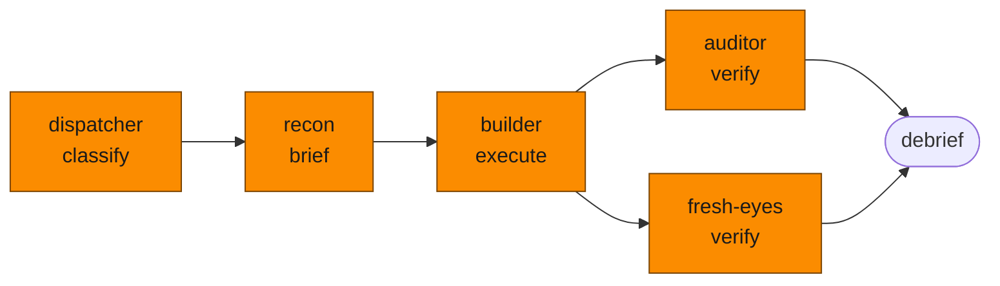

<div align="center">


# Sellsword

*The sellsword takes one hard job, sees it through, and brings back proof it is done.*

**Hire it for one hard problem. It owns the outcome: investigate, plan, execute, verify.**

[](.claude-plugin/plugin.json)
[](../../LICENSE)
[](https://docs.claude.com/en/docs/claude-code)

</div>

> [!NOTE]
> **Sellsword is a standalone plugin.** Install it on its own - there's nothing else to add. It doesn't shell out to any other tool in this marketplace, and it doesn't expect one to be installed alongside it.

---

## When to use it

| Reach for it when | Don't bother when |
|---|---|
| The problem crosses the repo boundary - half code, half deploy config, half a box you have to SSH into | The change is self-contained in the repo. A function to fix, a feature to add, a failing test to green - an ordinary editing session gets there faster and cheaper |
| You can't yet tell whether it's a bug, config drift, or an environment difference, and finding out *is* most of the work | You already know exactly what to change and where. Sellsword will still run five agents to confirm what you could have typed |
| The outcome has to be proved rather than asserted - two verifiers running real commands against real state | You want a design critique or a code review. Sellsword checks that it works, not that it's shaped right |
| You want to set a finish line and walk away (`/sellsword:goal`) | The work is a steady stream of small repo-scoped items - that's a backlog loop, not one gnarly problem |

---

## The contract

| | |
|---|---|
| **Job** | Whatever you describe, free-form - no task-type picker |
| **Agents on this job** | dispatcher, recon, builder, auditor, fresh-eyes - 5 agents |
| **Sign-off** | Two independent verifiers, each with a real evidence ledger |
| **Scope** | Code, infra, and live systems - not confined to the repo |

Most of the other regulars each do one kind of work; Sellsword is the one you hire when the problem doesn't respect a single boundary - it's half a bug, half a deploy, half an SSH session. It gathers context, proposes a plan when the work touches real state, then executes and proves the outcome by observation, not by inference.

**What makes Sellsword different from a code-editing agent: it operates on real systems.** SSH sessions, `terraform`, `kubectl`, package mirrors, live deploys - anything you'd otherwise do by hand at a terminal is fair game. That's the reason to reach for Sellsword specifically, rather than a plugin that only ever touches files in the repo.

---

## Install

```bash
claude plugin marketplace add gshepptech/the-tavern
claude plugin install sellsword@the-tavern
```

Then hand it something:

```
/sellsword:do why is staging login broken since yesterday
```

---

## The party



| Role | Job |
|---|---|
| **dispatcher** | One-shot classifier. Reads the intent (and peeks at the repo shape - up to 6 tool calls) and emits initial mode (`investigating`/`planning`/`executing`), scope, side-effect surface (`none`/`local`/`remote`/`production`), and whether a plan checkpoint is required. Doesn't investigate - that's recon's job. |
| **recon** | Builds the brief the builder works from: what the codebase says, what memory and git history remember, targeted web research, and - critically - the **verification surface**, the concrete commands that would prove the outcome real. Bounded to **30 tool calls / 6 minutes** (doubled to 60 / 12 minutes under `--thorough`). Writes an honest, unverified assumption ledger rather than guessing. |
| **builder** | A single persona that self-switches between `investigating`, `planning`, `executing`, and `verifying`, and declares `stuck` rather than thrashing (after 4 failed reflections on the same step). Journals every action, verifies every claim it makes about real-system state, and refuses to act on scope it wasn't asked for. |
| **auditor** | Adversarial verifier. Deliberately starved of the builder's journal, reflections, and followups - it only reads the intent, the brief's verification surface, the plan, and the *current* state of real systems. Every verdict must ship with an **evidence ledger**: real commands it ran, real output it captured. A `pass` with unfixed critical findings is a contradiction the orchestrator rejects. |
| **fresh-eyes** | Blind drift check. Sees only the original intent and the current state of code/systems - no brief, no plan, no journal, no auditor verdict. Parses the intent into parts and checks each one is observably true. Catches the failure the auditor can't: the whole run quietly solving a different, adjacent problem. Also carries a mandatory evidence ledger. |

**On stuck:** the builder doesn't loop forever. Sellsword spawns three variants in parallel with deliberately different framings - config/wiring, environment/dependency, permissions/network - then an arbiter reads all three and picks the most productive path.

---

## How a job runs: `/sellsword:do` vs `/sellsword:goal`

Both commands drive the same agents and the same evidence discipline. They differ in **who watches**.

| | `/sellsword:do` | `/sellsword:goal` |
|---|---|---|
| Checkpoint | One plan-approval stop for side-effecting work - you reply go / revise / ask first / cancel | **None.** No plan, no budget questions |
| Loop | Verifies once; retries up to 3 audit-cycles, then hands back to you | Runs cycle after cycle until it converges, or a cap fires |
| Ends when | Debrief renders in chat and the turn ends | Auditor **and** fresh-eyes both return `pass`, or `--max-cycles`/`--max-hours` is hit |
| Enforcement | You're in the loop by design | A `Stop` hook (`goal-gate.py`) blocks the turn from ending while the goal is unmet |

`/sellsword:do` asks for approval once when the initial mode is `planning`, or side effects are `remote`/`production`, unless you pass `--yolo` - pure investigation with no side effects skips the checkpoint entirely.

> [!WARNING]
> **Know which promises are enforced and which are asked for.** Exactly one thing here is enforced by a hook the model cannot talk past: the `Stop` hook (`goal-gate.py`) blocks a `/sellsword:goal` run from ending until the goal is met or a cap fires. That is real. Everything else about safety - the plan checkpoint, `--yolo` being overridden for production, `--allow-production` gating remote changes, production-tagged hosts forcing a checkpoint - is the orchestrator following its own instructions in `commands/do.md` and `commands/goal.md`. There is no separate program that reads the side-effect surface and refuses. In normal operation the model follows those instructions; they are not a barrier an adversarial or confused run cannot cross.
>
> **So the containment for Sellsword is the environment, not the prompt.** `/sellsword:goal` is genuinely unattended: the builder can SSH, redeploy and rewrite infrastructure across many cycles with nobody watching each step. Give it credentials scoped to what you are willing to let it touch, and point it at staging before production. `/sellsword:cancel <run-id>` is the clean early stop - it flips the run's status so the `Stop` hook stands down.

---

## Worked examples

Output below is illustrative. The plan block, the debrief blocks and the evidence ledger follow the orchestrator's and auditor's own render templates; the one-line status updates between phases are paraphrased, since those are specified as brief one-liners rather than fixed text. Your run's numbers and hosts will differ.

### 1. A staging outage nobody can explain

Staging started returning 502s after yesterday's deploy and nobody remembers changing anything.

```bash
/sellsword:do why is staging returning 502 since yesterday's deploy
```

Sellsword classifies it, recons, and - because the work reaches a remote host - stops once for approval before touching anything:

```text
Starting Sellsword run sellsword-20260518-141522-a3f4. Classifying intent…
Dispatcher classified: mode=investigating, scope=standard, side_effects=remote, checkpoint=true. Recon…

**Plan for: why is staging returning 502 since yesterday's deploy**

## What I learned
- nginx is up; the app unit restarted cleanly at 09:12 and is listening
- nginx error log is full of `connect() to unix:/run/app/old.sock failed`
- yesterday's deploy moved the socket path; the proxy config still names the old one

## Target outcome
Staging serves 200s again, from the app, with the proxy pointed at the live socket.

## Plan
1. Restore the upstream socket path in `/etc/nginx/conf.d/app.conf` - verification: `nginx -t` passes
2. Reload nginx - verification: `systemctl status nginx` shows a clean reload, no workers dying
3. Confirm the flow end to end - verification: `/health` returns 200 and no new 502 in the journal

## Risks I'll handle in flight
- Config drift elsewhere in the file - I diff against git before editing, and only touch the upstream line

## Assumptions still unverified
- [ ] No other service is bound to the old socket path

---
Reply **go** to execute, or push back / edit / ask questions.
```

Answer **go** and it executes, then runs both verifiers in parallel and debriefs:

```text
**Done** - sellsword-20260518-141522-a3f4

**What I did**
- Found nginx upstream pointing at /run/app/old.sock; the unit now binds /run/app/app.sock
- Restored the socket path in /etc/nginx/conf.d/app.conf and reloaded nginx

**Verified**
- /health returns 200 - `curl -sI https://staging.example.com/health` -> HTTP/2 200
- no 502s since reload - `ssh staging 'journalctl -u nginx --since "10 min ago" | grep -c 502'` -> 0

**Auditor verdict:** pass
**Fresh-eyes verdict:** pass

**Open follow-ups** *(not blockers)*
- The socket path is hardcoded in two places; worth templating

**Run artifacts:** `.sellsword/runs/sellsword-20260518-141522-a3f4/`
```

The two verdicts are not a formality. Each one is backed by a ledger of commands actually run - a verdict without one is rejected by the orchestrator and the agent is re-spawned.

<details>
<summary><b>What the auditor's evidence ledger looks like</b> (from <code>auditor-verdict.md</code>)</summary>

```markdown
## Evidence ledger

| # | check | command | output (condensed) | verdict |
|---|---|---|---|---|
| 1 | health endpoint reachable | `curl -sI https://staging.example.com/health` | `HTTP/2 200` | pass |
| 2 | nginx config references live socket | `ssh staging 'grep -n upstream /etc/nginx/conf.d/app.conf'` | `proxy_pass http://unix:/run/app/app.sock` | pass |
| 3 | no 502s since reload | `ssh staging 'journalctl -u nginx --since "10 min ago" \| grep -c 502'` | `0` | pass |
| 4 | app unit healthy | `ssh staging 'systemctl status app'` | `active (running) since 14:31` | pass |
```

Fresh-eyes writes its own ledger independently, keyed on the parts of your original sentence rather than on the plan - it never reads the brief, the plan, the journal, or the auditor's verdict. That's the check that catches a run which quietly solved an adjacent problem.

</details>

**Next:** take the follow-up or leave it. Nothing to clean up - the run dir is only there for `/sellsword:resume` and for auditing what happened.

### 2. A finish line, unattended

The auth test suite has been red for a week for several unrelated reasons, and you'd rather come back to it done than babysit it.

```bash
/sellsword:goal every test under test/auth passes and `npm run lint` exits 0 --max-cycles=8
```

No plan checkpoint, no questions. Sellsword cycles builder -> auditor -> fresh-eyes until both verifiers pass or a cap fires:

```text
Starting unattended goal run sellsword-20260518-092013-77c1.
Condition: every test under test/auth passes and `npm run lint` exits 0
Caps: 8 cycles / 6h. Walk away - I run until auditor + fresh-eyes both pass.

Cycle 1 - auditor: fail · fresh-eyes: partial
Cycle 2 - auditor: conditional-pass · fresh-eyes: pass
Cycle 3 - auditor: pass · fresh-eyes: pass

**Goal met** - sellsword-20260518-092013-77c1

**Outcome** - 3 cycle(s), 41m
auditor: pass · fresh-eyes: pass

**What Sellsword did**
- Fixed the expired fixture token generator (test/auth/fixtures.ts)
- Replaced two assertions that depended on wall-clock ordering
- Cleared 6 lint errors introduced by the fixture rewrite

**Verified**
- suite green - `npx vitest run test/auth` -> 34 passed, 0 failed
- lint clean - `npm run lint` -> exit 0

**Run artifacts:** `.sellsword/runs/sellsword-20260518-092013-77c1/`
```

**Next:** read the diff before you push. `/sellsword:goal` optimises for the condition you wrote, so a badly-worded condition is met exactly as badly as it was worded.

---

## What it costs

Every agent Sellsword hires is Opus, so a run is not cheap. Roughly what you're buying:

- **`/sellsword:do`**: five agent spawns minimum (dispatcher, recon, builder, auditor, fresh-eyes). Recon is capped at **30 tool calls / 6 minutes**, the builder at **120 tool calls / 30 minutes**; `--thorough` doubles both. Failed verification re-spawns the builder, capped at **3 audit-cycles**. A builder that declares `stuck` fires three parallel variants plus an arbiter - that's the single most expensive path, and it only fires on declared stuck.
- **`/sellsword:goal`**: the same five agents, once per cycle, defaulting to **15 cycles or 6 hours**, whichever comes first. Bound it with `--max-cycles=N` and `--max-hours=N`; the defaults are generous.
- **Cheapest useful shape**: `/sellsword:do --scope=quick` on a narrow intent, which keeps recon and the builder inside the standard budgets.

---

## Commands

| Command | Does |
|---|---|
| `/sellsword:do <intent> [--thorough] [--yolo] [--scope=quick\|standard]` | Investigate, plan, execute, then verify one free-form intent, with a single plan checkpoint for side-effecting work |
| `/sellsword:goal <condition> [--max-cycles=N] [--max-hours=N] [--allow-production] [--thorough]` | Set a completion condition; run unattended until auditor **and** fresh-eyes both pass, capped by cycles or time |
| `/sellsword:list [--all\|--active\|--completed]` | Table of recent runs from `.sellsword/runs/`, read-only |
| `/sellsword:resume [<run-id>]` | Pick an interrupted run back up from its on-disk state - trusts `state.json` over re-inference |
| `/sellsword:cancel [<run-id>]` | Mark a run cancelled; offers to also delete its run dir (the only destructive op the orchestrator performs itself, and it's confirmed first) |
| `/sellsword:help` | This plugin's own help text, in-session |

---

## Configuration

`.sellsword/hosts.yml` is optional. If it exists, the dispatcher and builder use it instead of re-learning hosts every run:

```yaml
hosts:
  staging:
    ssh: ubuntu@staging.example.com
    tags: [dev, azure, rhel]
  prod:
    ssh: deploy@prod.example.com
    tags: [production, azure, rhel]
```

Any host tagged `production` forces the plan checkpoint regardless of `--yolo`.

`/sellsword:goal`'s preflight also checks for the `warden` plugin's strict-mode marker if it's present - an unattended run can't survive an interactive block, so it refuses to start until strict gates are confirmed off. If you don't have `warden` installed, this doesn't apply to you.

---

## The job file

Every run writes to `.sellsword/runs/<run-id>/`:

```
.sellsword/runs/sellsword-20260518-141522-a3f4/
├── state.json              # status, phase - drives /sellsword:resume and /sellsword:list
├── dispatcher-config.json
├── brief.md                # recon's territory map + verification surface
├── plan.md                 # builder's plan (checkpoint runs only)
├── journal.md              # builder's append-only action log
├── reflections.md          # what failed attempts taught the builder
├── verification.md         # builder's own pass over the verification surface
├── auditor-verdict.md      # adversarial verdict + evidence ledger
├── fresh-eyes-verdict.md   # blind-drift verdict + evidence ledger
├── followups.md            # out-of-scope things noticed, never acted on
├── escalation.md           # only if the builder declared stuck
└── retry/                  # only if multi-angle retry fired
    ├── variant-A/ variant-B/ variant-C/
    └── synthesis.md
```

The plan and the debrief render in chat - you never have to open these files. `/sellsword:goal` also writes `.sellsword/active-goal.json` at the project root while a run is armed; every exit path empties it.

---

## Shared workspace (optional)

Sellsword is the one that goes outside the repo, so it tends to learn things the repo does not record. At the end of a run, if there is something a different tool could act on (open follow-ups, a constraint it hit, a drift flag nobody acted on), it writes one small JSON note to `.questboard/notes/`. A run that did exactly what was asked and found nothing surprising writes nothing.

This matters most for `/sellsword:goal`, which is unattended: the chat debrief has nobody reading it.

Nothing operational goes in the note. No credentials, no hostnames, nothing from `.sellsword/access.yml`. That detail belongs in `.sellsword/runs/<id>/`, which stays local to Sellsword.

Sellsword reads nothing from the workspace and never fails a run over a failed write. The format is documented in [the .questboard contract](../../docs/questboard-contract.md).

## Pairs well with

Sellsword stands on its own, but if you've also hired other regulars from The Tavern:

- [Ranger](../ranger/README.md): a self-directing loop that keeps a backlog and ships small commits continuously, if the work is a steady stream of repo-scoped items rather than one gnarly problem.
- [Seer](../seer/README.md): a design-cohesion reviewer, if you want a second opinion on whether Sellsword's changes are shaped right, not just whether they work.

---

## License

Apache-2.0. See [LICENSE](../../LICENSE). © 2026 gshepptech
