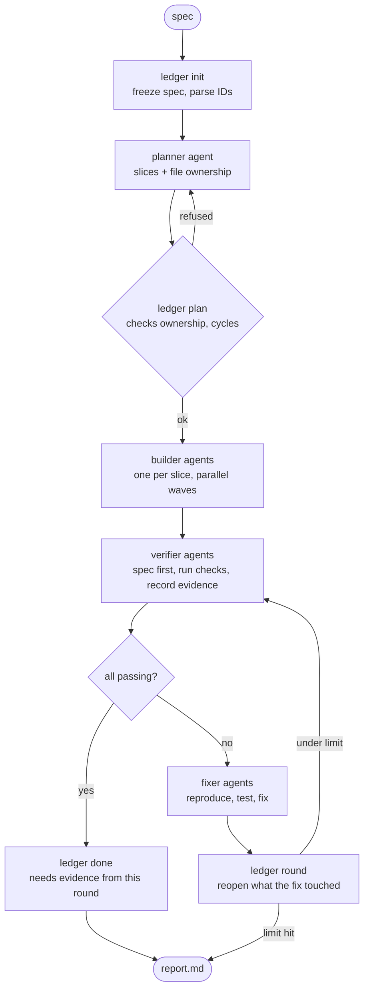

# Smith

*The smith works from the written plan, splits the job across several hands, and has every piece checked before it leaves the shop.*

**Builds a spec with numbered requirements and acceptance criteria, with every requirement checked by a verifier that
never saw how it was built.**

[](.claude-plugin/plugin.json)
[](../../LICENSE)
[](scripts/ledger.py)

## What it does

An agent that builds something and then checks its own work tends to find that it works. Smith separates the two.
Builders implement slices of the spec in parallel. Verifiers start from the spec, not from the builders' account,
run real checks and record what they saw. A small ledger script owns the state of the build and refuses to call a
requirement done until a verifier has recorded a passing command and its output in the current round. Failures go to
fixers, and everything a fix could have affected is checked again.

## Features

- **Works from any spec with IDs.** A sealed [Sage](../sage/README.md) spec, or your own markdown with `R-1`, `FR-001`
  or `US-3` style IDs in headings, list items or table rows. Criteria are read from `Acceptance` lists and nested
  bullets.
- **Explicit file ownership.** The planner gives every slice the files it may edit. The ledger refuses a plan where a
  requirement is unowned or a file belongs to two slices.
- **Parallel waves.** Slices with no dependency between them build at the same time, up to `--max-parallel`.
- **Independent verification.** Verifiers get the spec and the requirement IDs. They never see builder notes, briefs
  or reports.
- **Evidence or it is not done.** A pass must carry the command that was run and its output. Evidence from an earlier
  round does not count after a fix.
- **Bounded fix loop.** Fix, re-verify, repeat, up to `--max-rounds`. A fix reopens every requirement whose slice owns
  a file it touched.
- **Safe with git.** Smith works on a `smith/<run>` branch, commits by explicit path, and never pushes.

## Quick start

```bash
claude plugin marketplace add gshepptech/the-tavern
claude plugin install smith@the-tavern
```

Then, in a git repository with no uncommitted changes:

```
/smith:build sage-specs/orders-csv-export/spec.md
```

With Sage installed, `/smith:build` with no path builds the newest spec Sage sealed.

## How it works



The lead (your session) only routes work: it asks the ledger for the next action, spawns agents, and commits. Each
agent has one job:

| Agent | Job | Sees |
|---|---|---|
| `planner` | split requirements into slices with owned files and dependencies | spec, code |
| `builder` | implement one slice test-first, inside its own files | its requirements, files, brief |
| `verifier` | check requirements against the code and record verdicts | spec, code |
| `fixer` | reproduce a failure, add a failing test, fix it | failing requirements, verifier evidence |

## Reference

### Commands

| Command | What it does |
|---|---|
| `/smith:build [spec] [--max-rounds N] [--max-parallel N]` | Start a build. Defaults: 3 fix rounds, 4 agents at once |
| `/smith:build --resume <run>` | Continue a stopped run from the ledger's next action |
| `/smith:status [run]` | Slices, verdicts by status and the next step |
| `/smith:help` | A short summary |

### The ledger

`scripts/smith` wraps `scripts/ledger.py`. Every command prints one JSON line and exits 1 with a `refused` message
when it will not do what was asked.

```bash
smith init SPEC [--name RUN] [--max-rounds N] [--max-parallel N]
smith plan --file plan.json
smith slice S1 --status building|built|failed
smith owners FILE...
smith record R-001 --verdict pass --command "pytest -q" --output-file out.txt --exit 0 --location app.py:12
smith done R-001 | --all-passing
smith round --touched FILE...
smith status
smith report
```

`--root DIR` and `--run NAME` go before the command. A spec whose `sealed_by` line no longer matches its content is
refused at `init`; an unsealed spec is accepted.

### Files

```
.smith/                  ignores itself in git
  runs/<run>/
    spec.md              the spec as it was when the run started
    ledger.json          requirements, slices, waves, evidence, rounds
    plan.json            the planner's output
    notes/<slice>.md     builder notes, never shown to verifiers
    report.md            the final report
```

## Shared workspace (optional)

With no spec path, `/smith:build` asks `.questboard/` for the newest `spec` note whose file still exists, and says which
spec it picked. When a run ends it writes one `attempt` note pointing at the report, with outcome `done` or `failed`.
With no `.questboard/` directory Smith behaves the same, except that it asks you for the spec path. See
[the contract](../../docs/questboard-contract.md).

## Development

```bash
cd plugins/smith
uv run --with pytest python -m pytest -q
```

The tests cover spec parsing in several formats, plan checks, wave ordering, the evidence rule for `done`, fix-round
reopening and limits, the report, and the shared-workspace helper.

## License

Apache-2.0. See [LICENSE](../../LICENSE).
