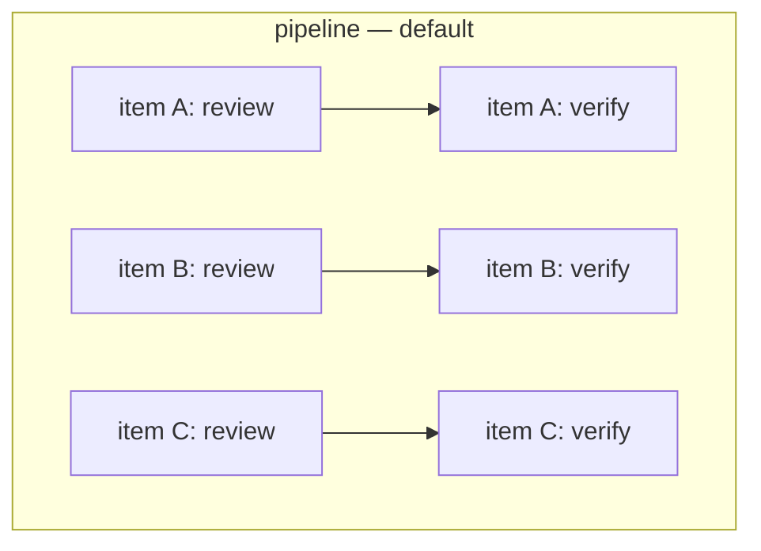
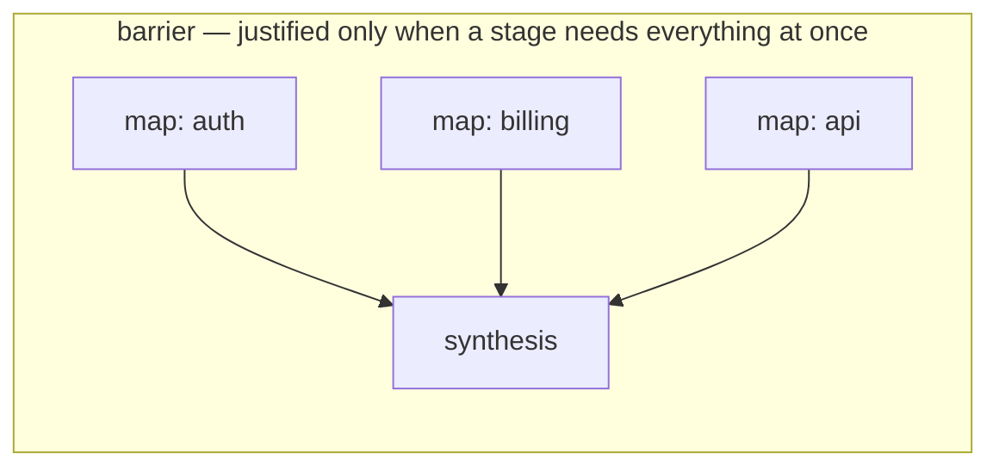

<div align="center">


# Tactician

*The tactician plans the formation: it writes the multi-agent Workflow script for a job so you do not freehand one.*

**Say what you want done. Tactician writes the multi-agent script that does it — and hands you the file.**

[](.claude-plugin/plugin.json)
[](../../LICENSE)
[](https://docs.claude.com/en/docs/claude-code)

</div>

> [!NOTE]
> **Tactician is standalone.** Point it at one task, get one script back — no other plugin required. It does need Claude Code's **Workflow tool** (the dynamic multi-agent orchestrator) since that's what the generated script runs on. If your Claude Code reports Workflow as unavailable, that's a version/plan matter, not something you install here — Tactician still writes the script, but you won't be able to run it until the tool is present.

---

## When to use it

| Reach for it when | Don't bother when |
|---|---|
| The job is genuinely N-of-something — twenty call sites to migrate, several angles to review a diff from, four subsystems to map | A single agent would do. **Most tasks don't need orchestration**; a workflow adds a topology you then have to reason about |
| You'll run the same shape more than once — a review you want on every branch, a sweep you repeat per topic | It's a one-off you'll never repeat. Just ask Claude directly and skip the artifact |
| You want the fan-out deterministic and readable — a file you can diff, edit and hand over, not a prompt you hope behaves | The work is inherently serial: each step needs the last step's result, so there is nothing to fan out |
| You know the Workflow tool exists but suspect you're getting the details wrong — barriers, schemas, budget guards | You already have a script that works. Tactician authors new ones; it isn't a linter for existing ones |

---

## The problem it solves

Claude Code's Workflow tool can fan subagents out however you like — one at a time, in a pipeline, all in parallel with a barrier, in a loop that runs until the work dries up. That freedom is also the trap: it's easy to write a script that barriers everything for no reason, parses an agent's prose as JSON and prays, or forgets to cap a budget loop and burns through a thousand agents. Getting the topology *and* the hygiene right by hand, every time, is tedious.

Tactician does that thinking for you. Tell it a task in plain English; it works out the shape of the job, writes the script, checks its own homework, and hands you a file you can read, run, edit, and keep.

```
/tactician:make review the current diff for bugs and prove each finding is real
```

---

## Install

```bash
claude plugin marketplace add gshepptech/the-tavern
claude plugin install tactician@the-tavern
```

Then write a script:

```
/tactician:make research how teams do blue-green deploys on k8s and write a cited report
```

Tactician classifies the task, picks a topology, writes the script to `.claude/workflows/`, and tells you how to run it.

---

## How it picks a shape

Every task gets asked the same four questions before a line of code is written:

- **What's the unit of work?** Files, findings, search angles, migration sites, design angles?
- **Is the work-list size known up front, or discovered as you go?** Known means `pipeline`/`parallel`. Unknown means loop until results dry up, or until the budget runs low.
- **Does any single stage genuinely need *all* prior results at once?** Dedup, an early-exit on a running total, a synthesis that has to see every map — that stage gets a barrier. Everything else doesn't.
- **Does anything mutate files in parallel?** If so, those agents run in isolated worktrees so they don't collide.

If the task is too vague to answer the first two, Tactician asks one clarifying question rather than guessing — the topology is the whole point, so it won't invent one.

### Pipeline vs. barrier — the one idea worth taking away even if you never install this

A **pipeline** runs each item through every stage independently, with no synchronisation between them — item A can be three stages ahead of item B. This is the default, because most "separate stages" people reach for a barrier for don't actually need one; a finding can be verified the moment it lands, without waiting for every other finding to be reviewed first.

A **barrier** (`parallel()` awaited as a batch) stops the line until every item has finished the current stage, because the *next* stage needs to see all of them together — a synthesiser summarising four subsystem maps, a dedup pass, an early-exit once a running total is known. Tactician only reaches for a barrier when it can name that cross-item dependency; "the stages feel conceptually separate" doesn't count.





Get this distinction wrong and a review either serialises pointlessly (waiting on a barrier that didn't need to exist) or a synthesis runs on partial data (skipping a barrier that did). Tactician defaults to pipeline and demands a named reason before it'll write a barrier.

---

## What you get

A plain JavaScript file, saved under `.claude/workflows/<name>.js`, that you can read end to end — no hidden state, no black box. An excerpt from a real `review` task, showing the shape Tactician writes:

```js
export const meta = { name: 'review-diff', description: 'Review a diff for bugs, prove findings real', phases: ['Review', 'Verify'] }

const DIMENSIONS = [{key:'bugs', prompt:'...'}, {key:'perf', prompt:'...'}, {key:'security', prompt:'...'}]
const results = await pipeline(DIMENSIONS,
  d => agent(d.prompt, {label: `review:${d.key}`, phase: 'Review', schema: FINDINGS_SCHEMA}),
  review => parallel((review.findings || []).map(f => () =>
    agent(`Adversarially verify this finding — try to REFUTE it. Default to refuted if uncertain: ${f.title}`,
          {label: `verify:${f.id}`, phase: 'Verify', schema: VERDICT_SCHEMA}).then(v => ({...f, verdict: v})))))
const confirmed = results.flat().filter(Boolean).filter(f => f.verdict && f.verdict.isReal)
return { confirmed }
```

Each dimension runs its own review-then-verify chain independently — no barrier between them, because verifying one finding never needs another dimension's results.

You own this file. Edit it, re-run it, hand it to someone else, or invoke it later by name.

---

## Commands

| Command | What it does |
|---|---|
| `/tactician:make <task> [--run] [--save=<name>] [--args=<json>]` | Classify the task, pick a topology, write and validate the script, save it to `.claude/workflows/`. Add `--run` to execute it immediately once validated. `--save` names the file (otherwise derived from the task); `--args` is JSON passed through as the workflow's `args` input. |
| `/tactician:help` | Usage guide and the archetype table, printed in chat. |

> [!TIP]
> Running is opt-in on purpose — a workflow can spawn dozens of agents and burn real tokens. Without `--run`, Tactician authors and saves the script and stops there; you decide when to spend the budget.

### The archetypes

| Archetype | Shape |
|---|---|
| **understand** | parallel readers per subsystem, then one synthesis (barrier justified — the synthesiser needs every map at once) |
| **design** | N approaches from different angles, then a judge panel scores each, then synthesise the winner |
| **review** | dimensions in a pipeline, each finding adversarially verified the moment it lands |
| **research** | multi-modal sweep, then deep-read, then verify claims, then cited synthesis |
| **migrate** | discover sites, then transform each in an isolated worktree, then verify |
| **generic** | loop-until-dry or loop-until-budget, for work whose size isn't known up front |

These are starting points Tactician composes freely, not a fixed menu — a task can blend two.

---

## Worked examples

Output samples below are **illustrative** — abbreviated versions of the shape `/tactician:make` prints (`commands/make.md`, STEP 4) and the script shapes in [`references/rulebook.md`](references/rulebook.md). A real run is written against your task.

### 1. A branch review you can keep

You want the same multi-angle bug review on every branch, not a fresh prompt each time.

```
/tactician:make review the current branch diff for correctness, security and performance bugs and prove each finding is real --save=review-branch
```

```
REVIEW: pipeline of 3 dimensions — each finding adversarially verified the moment it lands.
No barrier: verifying a security finding never needs the performance review's results.

Saved: .claude/workflows/review-branch.js
node --check passed · 14-point self-audit 14/14

Run it:  Workflow({scriptPath: ".claude/workflows/review-branch.js"})
```

It prints the script itself alongside that summary — the point of Tactician is that you
read the harness before you trust it, so it is never hidden behind a file path:

```js
export const meta = { name: 'review-branch', description: 'Review the branch diff across 3 dimensions, verify each finding', phases: ['Review', 'Verify'] }

const DIMENSIONS = [
  {key: 'correctness', prompt: 'Review the current branch diff for correctness bugs...'},
  {key: 'security',    prompt: 'Review the current branch diff for security bugs...'},
  {key: 'performance', prompt: 'Review the current branch diff for performance bugs...'},
]

const results = await pipeline(DIMENSIONS,
  d => agent(d.prompt, {label: `review:${d.key}`, phase: 'Review', schema: FINDINGS_SCHEMA}),
  review => parallel((review?.findings ?? []).map(f => () =>
    agent(`Try to REFUTE this finding: ${f.title}. Default to refuted if uncertain.`,
          {label: `verify:${f.file}`, phase: 'Verify', schema: VERDICT_SCHEMA})
      .then(v => ({...f, verdict: v})))))

return { confirmed: results.flat().filter(Boolean).filter(f => !f.verdict?.refuted) }
```

**Next:** read the file, then run it — `--run` on the original command, or just ask for it by name later.

### 2. A migration across call sites

An old helper is used all over the repo and every site needs the same edit plus a compile check.

```
/tactician:make port every call site of the old fetchJSON helper to the new httpClient wrapper and verify each one still compiles --save=port-http-client
```

An excerpt of what lands in `.claude/workflows/port-http-client.js`:

```js
export const meta = { name: 'port-http-client', description: 'Port fetchJSON call sites to httpClient and verify each', phases: ['Migrate', 'Verify'] }

const sites = (args && args.sites) || []
if (!sites.length) return { error: 'Pass args.sites — the call sites to port.' }

const verified = await pipeline(sites,
  site => agent(`Port ${site} from fetchJSON to httpClient. Edit in place; behaviour must not change. Return the diff.`,
                {label: `migrate:${site}`, phase: 'Migrate', isolation: 'worktree', schema: DIFF_SCHEMA}),
  (diff, site) => agent(`Verify the port of ${site} compiles and preserves behaviour. Return pass/fail plus evidence.`,
                {label: `verify:${site}`, phase: 'Verify', schema: VERDICT_SCHEMA}).then(v => ({site, diff, v})))
return { verified: verified.filter(Boolean) }
```

Two things to notice: `isolation:'worktree'` appears here and nowhere in example 1, because these agents mutate files in parallel and would otherwise collide; and the site list comes from `args`, so the script outlives this one migration.

**Next:** run it with the sites you want — `Workflow({scriptPath: ".claude/workflows/port-http-client.js", args: {sites: ["src/api/orders.ts", "src/api/users.ts"]}})`.

### 3. Mapping an unfamiliar repo, run immediately

New codebase, and you want the map now rather than a saved artifact.

```
/tactician:make map this repo for onboarding — entry points, data flow and key types per subsystem, then one architecture overview --save=onboard-map --run
```

```
UNDERSTAND: parallel readers, one per subsystem, then a single synthesis.
Barrier justified — the synthesiser needs every map at once.

Saved: .claude/workflows/onboard-map.js
node --check passed · 14-point self-audit 14/14
Running now, because --run was passed.
```

**Next:** the workflow returns `{maps, summary}`; re-run it after the next big refactor rather than re-reading the repo by hand.

---

## What it costs

Authoring is cheap. `/tactician:make` runs in your session — read the rulebook, write the file, `node --check`, self-audit. It spawns no subagents.

The cost lands when the script *runs*, and it scales with the fan-out you asked for: a pipeline over twenty migration sites with a verify stage is forty agents, each with its own context window. That is why `--run` is opt-in, why any coverage cap gets `log()`-ged rather than hidden, and why a budget loop must guard on `budget.total` — without a target, `remaining()` is `Infinity` and the loop runs to the runtime's hard agent cap.

Bounds worth knowing: no `--run` means nothing is spent beyond authoring; `--args` lets you run the same script over a short site list first; and a loop-shaped script terminates on K dry rounds or on `budget.total`, never on a wall-clock guess.

---

## What makes the output good

Every script is checked against the same rules before Tactician will call it done:

- **Pure-literal `meta`** — no computed values in the export, phase titles match the `phase()` calls used.
- **Pipeline by default** — `parallel()` only where a named cross-item dependency justifies the barrier.
- **`schema` for every structured return** — agents return validated objects; nothing gets `JSON.parse`d out of prose.
- **`.filter(Boolean)`** on every fan-out result, since a skipped or thrown agent resolves to `null`.
- **`isolation:'worktree'` only where agents mutate files in parallel** — it costs real time and disk, so it's not the default.
- **Budget loops guarded on `budget.total`** — otherwise an unbounded loop runs to the hard agent cap.
- **No `Date.now()` / `Math.random()` / argless `new Date()`** — they break resumability and throw.
- **No silent caps** — any top-N or sampling limit is logged, not hidden.
- **Parameterised over `args`** — a script hardcoded to one run is a worse artifact than one you can reuse.

Tactician then runs `node --check` on the file and walks a 14-point self-audit against it, fixing anything that fails before showing it as finished. The full rulebook — hooks, hard rules, archetype skeletons, schema authoring — lives in [`references/rulebook.md`](references/rulebook.md).

---

## Pairs well with

Tactician writes standalone scripts — nothing here depends on another plugin. Its output is a plain Workflow script, so it composes with whatever else you're running in the same Claude Code session, without any wiring on Tactician's part:

- [Sellsword](../sellsword/README.md) — for a gnarlier problem Sellsword owns end to end, a Tactician-authored script is one more tool available if the work genuinely calls for multi-agent fan-out.
- [Ranger](../ranger/README.md) — if a backlog item needs real fan-out (a multi-angle review, a wide migration), write a script for that one cycle rather than hand-rolling the orchestration.

## License

Apache-2.0 — see [LICENSE](../../LICENSE). © 2026 gshepptech
