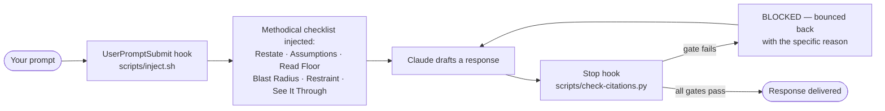

<div align="center">


# Warden

*The warden keeps watch over every reply and turns back any claim that was not checked.*

**Methodical-mode guardrails for ad-hoc Claude Code work.**

[](.claude-plugin/plugin.json)
[](../../LICENSE)
[](https://docs.claude.com/en/docs/claude-code)

</div>

> [!NOTE]
> **Warden is entirely standalone.** Install it on its own, in any project, with nothing else from this marketplace. It doesn't need a spec, a plan, or a build loop upstream — it makes *every* ad-hoc Claude Code turn more careful, starting the moment it's installed.

Most ad-hoc work with Claude races: read a few files, edit a few more, declare done — then you find it missed the rate limiter you already had, or silently broke a test. CLAUDE.md and memory don't fix this because they're passive text Claude can skim past. Warden fixes it at the runtime: a checklist injected before every response, and a set of gates that mechanically check the response against that checklist before it's allowed to land.

## When to use it

| Reach for it when | Don't bother when |
|---|---|
| You're changing code you didn't write, in a repo too big for Claude to hold in context | You're writing a throwaway script nobody will read twice |
| A session confidently told you something about the codebase that turned out to be invented | You're asking a one-line general-knowledge question — "what's the flag for X?" |
| The work spans several files and "done" isn't obvious without checking | You're pairing closely and reading every diff yourself anyway |
| You want a record of what was actually verified rather than asserted | You need speed over certainty — a spike, a prototype, a demo in an hour |

## The loop



The preamble shapes the response before Claude writes a word. The Stop hook checks the finished response against reality — line by line, not by vibes — before it reaches you.

The checklist items in that diagram are specific asks, not slogans:

| Step | What Claude is required to do |
|---|---|
| **Restate** | Say in one sentence what you actually asked. If it could mean two things, ask instead of guessing. |
| **Assumptions** | List them, and mark each *verified* (it ran a Read or Grep this turn) or *unverified* (inference, training data, a subagent's summary). |
| **Read Floor** | Before changing code: read the relevant code end to end, grep for the symbols it will touch, and state the data flow in and out. Not "read ten files for ceremony" — read the things this change depends on. |
| **Blast Radius** | Before editing existing code: grep for callers and importers, and predict per caller whether the change keeps it working, breaks it, or quietly alters its behaviour. This is how you catch "I thought this was local but it has twelve callers" before you commit to it. |
| **Restraint** | Do only what was asked. No speculative features, no single-use abstractions, no while-I'm-here cleanups. |
| **See It Through** | Do not end a turn by promising work you were one tool call away from doing. |

## The gates

Five independent checks run at Stop. Each has its own on/off switch, so you can silence one without disabling the rest.

| Gate | Blocks a response that… | Default |
|---|---|---|
| **Citations** | Cites a `file:line` Claude didn't actually `Read`/`Grep` this turn | On |
| **Uncertainty** | Contains a self-flagged hedge — "not verified", "haven't checked", "I assumed" — without resolving it | On |
| **Completion (Fable-mode)** | Ends by *promising* first-person work ("I'll implement…", "let me run…") instead of doing it | On |
| **Grounding** | Answers a codebase-shaped question with zero `Read`/`Grep`/`Glob` calls this turn | On (strict) |
| **Iterative critic** | Fails a 10-item rule-compliance audit — rounds 1–3 by a cheap Haiku critic, rounds 4–6 escalate to an opus critic, hard-blocked at round 6 until you bypass it | On (strict) |

Subagent (`Task`/`Agent`) reads never satisfy the citation gate — a subagent's summary can paraphrase or hallucinate a line number, and its reads happen in a context Warden can't see. That's the exact failure mode the gate exists to catch.

> [!WARNING]
> **This trade-off is real.** Warden makes turns slower and more verbose — a preamble on every prompt, and up to six critic rounds when a response gets stuck in a block loop. It's built for correctness over speed. If you want Claude fast and unsupervised for a quick throwaway task, use one of the escape hatches below rather than fighting the gates.

## Install

```bash
claude plugin marketplace add gshepptech/the-tavern
claude plugin install warden@the-tavern
```

That's it — Warden activates on the very next turn. No command needed, nothing to configure.

## What it looks like

There's nothing to invoke — Warden acts on ordinary prompts. The samples below are abbreviated but the wording is the gates' own, from `scripts/check-citations.py`.

**1. Claude answers about code it didn't open.** You ask a question about a repo you've been working in all session:

```
> where do we enforce the per-user rate limit, and what's the window?
```

Claude answers from what it remembers of the session rather than re-reading, and cites lines. The Stop hook catches it and bounces the response back before you ever see it:

```
[warden:citations] Response contains 2 file:line citation(s) that were NOT Read or
Grep'd by you in this turn:
  - internal/middleware/ratelimit.go:88
  - internal/router/routes.go:142
Subagent (Task/Agent) calls do NOT count as direct verification — their internal
Reads are not visible here. For each unverified citation, either:
  1. Read the file yourself now and confirm the line is correct, or
  2. Remove the citation from your response.
(To disable this check: /warden:citations-off)
```

What you get is the second attempt: the same answer with the files actually read, or the citations dropped. **Next:** nothing — this one resolves itself. If a *correct* citation gets blocked, that's a signal to widen `CITATION_RE`.

**2. Claude ends the turn by promising work instead of doing it.** The subtler failure — the response reads as progress but nothing shipped:

```
> the users list query is slow in staging, sort it out
```

Claude diagnoses the missing index, writes a convincing paragraph, and signs off with an intention. The completion gate reads only the tail of the response, so a mid-response "let me check X" followed by actually checking doesn't trip it:

```
[warden:completion] Your response ends by stating an intent to do work ("I'll add
the missing index and re-run the migration") without actually doing it. This is
the race-to-a-promise pattern Fable-mode exists to catch. Do that work NOW with
tool calls — do not hand back a plan you could execute. End the turn only when
the task is complete (with evidence from a tool result this turn) or you are
genuinely blocked on input that only the user can provide — in which case ASK a
direct question instead of promising.
(To disable this check: /warden:fable-off)
```

**Next:** if the promise was deliberate — you wanted the plan, not the change — say so; a clarifying question passes the gate, a promise doesn't.

<details>
<summary><strong>3. A decision too big for the always-on preamble</strong></summary>

You're about to change how a service authenticates and you don't want the first plausible answer:

```
/warden:deep should we move session storage from the Postgres sessions table to Redis, given we're about to run three app instances behind a load balancer?
```

`/warden:deep` is read-only — `Read`, `Grep`, `Glob`, `Bash`, `WebFetch`, no `Edit`. It returns one document with seven fixed headings and nothing else:

```
## 1. RESTATE
Said: move sessions to Redis. Likely meant: make sessions work across three
instances. Might also mean: reduce write load on Postgres. These lead to
materially different work — flagging.

## 2. ASSUMPTIONS
A1 [VERIFIED] Sessions are read on every request — internal/auth/session.go:41
A2 [VERIFIED] No sticky sessions configured — deploy/nginx.conf:22
A3 [UNVERIFIED -> verified] Session rows are never joined against users ...
(5 more)

(then, in full: ## 3. PRIOR ART / ## 4. ALTERNATIVES — at least three, with
tradeoffs / ## 5. EDGE CASES / ## 6. RECOMMEND / ## 7. STOP-POINTS)

> **Awaiting your acknowledgement before any code changes.**
```

**Next:** you read it and decide. It will not start work off the back of its own recommendation.

</details>

## What it costs

The hooks themselves are shell and Python and cost nothing. The critic gate is the part to understand before installing:

- With `strict-on` (the default), **every response over 240 characters spawns at least one critic subagent.** Rounds 1-3 use a Haiku critic; rounds 4-6 escalate to Opus; round 6 hard-blocks until you run `/warden:trust-me`. A clean turn is one cheap round. A turn stuck in a block loop is up to six, three of them Opus.
- `/warden:deep` spawns nothing — one high-effort pass in your own session.
- `warden:second-opinion` is one Opus subagent, and only when you ask for it.

`/warden:strict-off` is the bound: it drops the critic and grounding gates and leaves citations, uncertainty and completion on. Those three are pure pattern-matching over the transcript — no model calls at all.

## Escape hatches

| When | Command |
|---|---|
| Trivial chitchat, preamble is noise | `/warden:casual` — skips the preamble for the next turn only, then auto-reverts |
| Genuine general-knowledge question, or the critic is stuck in a false PUSH BACK loop | `/warden:trust-me` — one-shot bypass of the grounding + critic gates for the next turn (citations + uncertainty gates stay on) |
| Long pairing session, preamble has done its job | `/warden:off` — silences the preamble until you run `/warden:on`; it persists across restarts, and the Stop gates keep firing |
| Want the preamble gone but not the safety net | `/warden:strict-off` — drops the grounding audit and critic gate; citations + uncertainty stay on |

## Commands

All commands live under `/warden:*`.

| Command | Effect | Scope |
|---|---|---|
| `/warden:status` | Show the state of every hook and gate | — |
| `/warden:on` | Re-enable the methodical-mode preamble | Persistent |
| `/warden:off` | Silence the preamble | Persistent |
| `/warden:casual` | Skip the preamble once | Next turn, auto-reverts |
| `/warden:citations-on` | Enable the citation verifier (default) | Persistent |
| `/warden:citations-off` | Disable the citation verifier | Persistent |
| `/warden:uncertainty-on` | Enable the uncertainty-tell scanner (default) | Persistent |
| `/warden:uncertainty-off` | Disable the uncertainty-tell scanner | Persistent |
| `/warden:strict-on` | Enable the grounding audit + iterative critic gate (default) | Persistent |
| `/warden:strict-off` | Disable the grounding audit + iterative critic gate | Persistent |
| `/warden:fable-on` | Enable the completion gate — see-it-through (default) | Persistent |
| `/warden:fable-off` | Disable the completion gate | Persistent |
| `/warden:trust-me` | One-shot bypass of the strict gates (grounding + critic) | Next turn, auto-consumed |
| `/warden:help` | Inline reference, verbatim | — |

"Persistent" means the setting survives across sessions until you flip it back — it's a marker file under `~/.claude/`, not a per-turn flag. There is no session-scoped setting: nothing clears these at a session boundary, so `/warden:off` stays off after a restart until you run `/warden:on`. "Next turn" means it consumes itself automatically after one use.

Both one-shot commands arm at the *start* of the turn they protect, not the end of the turn that sets them. That ordering is the whole trick: the Stop hook runs at the end of every turn, so a flag consumed there would be spent before your next prompt ever arrived.

## Beyond the always-on gates

<details>
<summary><strong>/warden:deep — a heavier read-only pass</strong></summary>

For non-trivial, ambiguous, or architectural tasks, `/warden:deep` runs seven structured steps — Restate, Assumptions (≥5, each verified or flagged), Prior art, Alternatives (≥3 with tradeoffs), Edge cases, Recommendation, Stop-points. It produces a written analysis and makes **zero code changes** — you decide what to do with it afterwards.

</details>

<details>
<summary><strong>warden:second-opinion — an independent critique</strong></summary>

A subagent with no prior conversation context, spawned via the Agent tool. Useful when you want a take from a Claude that hasn't anchored on your framing. Returns Agreements, Disagreements (with citations), Missed considerations, an Alternative approach, and a verdict: `CONCUR` / `CONCUR WITH CAVEATS` / `PUSH BACK` / `WRONG SHAPE`.

</details>

## Configuration

Warden keeps small marker files under `~/.claude/`. The hooks read them before firing; the toggle commands write or delete them. No daemons, no background processes.

| File | Controls |
|---|---|
| `~/.claude/.warden-state` | Preamble injection — absent/`on`, `off`, `casual` |
| `~/.claude/.warden-citations-mode` | Citation verifier — absent/`default`, `off` |
| `~/.claude/.warden-uncertainty-mode` | Uncertainty-tell scanner — absent/`default`, `off` |
| `~/.claude/.warden-strict-mode` | Grounding audit + iterative critic gate — absent/`default`, `off` |
| `~/.claude/.warden-fable-mode` | Completion gate — absent/`default`, `off` |
| `~/.claude/.warden-trust-me` | One-shot strict-gate bypass, written by `/warden:trust-me` |
| `~/.claude/.warden-trust-me-armed` | The same bypass, promoted at the start of the turn it protects and consumed at that turn's end |
| `~/.claude/.warden-citations-log.jsonl` | Log of every gate decision, for tuning. Redacted and size-capped — see below |

> [!TIP]
> Tail `~/.claude/.warden-citations-log.jsonl` after real use. Blocks against citations that turn out to be correct are a signal to widen `CITATION_RE` in `scripts/check-citations.py`; missed blocks are a signal to tighten it. The preamble itself lives in `scripts/inject.sh` if you want to soften, sharpen, or shorten it.

**What the log does and does not contain.** It is one file in your home directory that accumulates across every project you use Warden in, so it records only what tuning actually needs: which gate fired, counts, lengths, and the *basename* of a cited file. Response prose and matched phrases are reduced to their length, and absolute paths are reduced to a filename — so the directory structure of a private repo never lands in it. It rotates at 2 MB rather than growing forever. If you would rather it did not exist at all, delete it; nothing reads it back.

### Tests

```bash
python3 plugins/warden/tests/test_check_citations.py
```

The suite covers clean responses, fenced-block skipping, subagent-only reads (the key failure mode), diff-line markers, bare path mentions, off-mode short-circuit, Grep verification, log-write behaviour, and the completion gate (promise-blocks, clarifying-question pass, fable-off pass).

### Uninstall

```bash
claude plugin uninstall warden@the-tavern
rm -f ~/.claude/.warden-state ~/.claude/.warden-citations-mode ~/.claude/.warden-uncertainty-mode ~/.claude/.warden-strict-mode ~/.claude/.warden-fable-mode ~/.claude/.warden-trust-me ~/.claude/.warden-citations-log.jsonl
```

## What this isn't

- **Not a replacement for plan mode.** Plan mode (`Shift+Tab`) blocks edits outright; Warden shapes and checks the response instead. They compose.
- **Not a memory system.** Warden doesn't learn anything — it enforces. Pair it with your CLAUDE.md; Warden is the runtime that makes Claude actually look at it.
- **Not project-specific.** Nothing here assumes a spec, a plan, or a particular workflow upstream. It works the same in a five-minute bug fix as in a long session.

## Pairs well with

Warden doesn't need any of these — it's built to stand alone. But if you've hired other regulars from The Tavern, Warden's gates apply just as well to their output:

- [Sage](../sage/README.md) — spec the feature first; Warden keeps the implementation honest against it.
- [Smith](../smith/README.md) — Warden's citation and grounding gates fit naturally around an autonomous build loop.
- [Sellsword](../sellsword/README.md) — for a gnarlier problem Sellsword owns end to end, with the same discipline underneath.

## License

Apache-2.0 — see [LICENSE](../../LICENSE). © 2026 gshepptech
